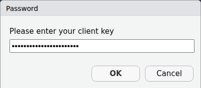

<!--
Please submit your abstract (600-1,000 words) to the submission portal, before 25 July 2025. When submitting, please select the section: “Special Issue: Short Video”

The abstract should outline the research objective, methodology, and expected contributions. Please also indicate the type of paper (e.g., empirical case study, tool/software development, theoretical/review paper) in the abstract.
-->

<!-- # Research Outline -->

Since the social media platform TikTok went live in Europe in August of 2018^[[https://www.theverge.com/2018/8/2/17644260/musically-rebrand-tiktok-bytedance-douyin](https://web.archive.org/web/20231122151117/https://www.theverge.com/2018/8/2/17644260/musically-rebrand-tiktok-bytedance-douyin)], it has quickly become one of the major players on the market.
As of early 2023, TikTok claims to have around 150 million users^[[https://newsroom.tiktok.com/en-eu/investing-for-our-150-m-strong-community-in-europe](https://web.archive.org/web/20231117185422/https://newsroom.tiktok.com/en-eu/investing-for-our-150-m-strong-community-in-europe)], many of whom are young and committed to the platform.
For instance, @newman_reuters_2023 position TikTok as the third most-used platform among 18-24 year olds.
Consequently, the platform's content has been attributed to various societal shifts, notably the increasing support for far-right parties among young voters in recent elections.^[[https://www.nytimes.com/2024/06/10/world/europe/germany-afd-eu-election.html](https://web.archive.org/web/20241003023927/https://www.nytimes.com/2024/06/10/world/europe/germany-afd-eu-election.html)].
Yet, despite TikTok's significant influence, Communication Research has only begun to explore its unique affordances, particularly its combination of video-centric content and algorithmically-driven user feeds [@boeker_empirical_2022].
Research challenges stem from both the computational complexity of analysing video content at scale and limited data access. 
<!-- As @cervi_tiktok_2023 note, they had to search and collect posts manually, since any official API access was not available at the time. -->
While TikTok's 2023 introduction of a Research API has improved this situation by providing vetted researchers with platform access, they do not provide tools to work with the API directly and the access remains both selective, limited in scope, and plagued by problems [@pearson_tiktok_api_2025].

The `R` package `traktok` addresses the data access challenges by combining an implementation of the TikTok Research API with access to TikTok content through their 'hidden' API.
This 'hidden' API is essentially what the website tiktok.com uses to display content to users, which was reverse-engineered to allow data collection.
By combining both access strategies, the shortcomings of each are mitigated.
Through the official Research API, it is, for example, not currently possible to access video content itself.
To allow researchers to analyze the videos and images on the platform, `traktok` offers to download the videos via functionality from the 'hidden' API.
On the other hand, the search for keywords and hashtags through webscraping techniques was blocked by TikTok in 2024 and can now only be done via the Reseacher API.
By implementing both pathways to TikTok data in a single package, `traktok` also enables researchers to seamlessly perform audits of both data access strategies against each other, where functions are available for both pathways.

## Outline

This contribution will showcase how both the TikTok Research API and the 'hidden' API can be employed and combined meaningfully.
@tbl-overview gives an overview of all functions in the package.

| Description                 | Shorthand        | Research API              | Hidden API              |
|:----------------------------|:-----------------|:--------------------------|:------------------------|
| search videos               | tt_search        | tt_search_api             | \-                      |
| get video detail (+file)    | tt_videos        | \-                        | tt_videos_hidden        |
| get user videos             | tt_user_info     | tt_user_videos_api        | tt_user_videos_hidden   |
| get user info               | tt_user_info     | tt_user_info_api          | tt_user_info_hidden     |
| get comments under a video  | tt_comments      | tt_comments_api           | \-                      |
| get who follows a user      | tt_get_follower  | tt_user_follower_api      | tt_get_follower_hidden  |
| get who a user is following | tt_get_following | tt_user_following_api     | tt_get_following_hidden |
| get videos a user liked     | tt_get_liked     | tt_user_liked_videos_api  | \-                      |
| get pinned videos of users  | tt_get_pinned    | tt_user_pinned_videos_api | \-                      |
| get videos in a playlist    | tt_playlist      | tt_playlist_api           | \-                      |
| get raw video data          | \-               | \-                        | tt_request_hidden       |
| authenticate a session      | \-               | auth_research             | auth_hidden             |

: Function overview of `traktok`  {#tbl-overview}

For example, the Research API offers a fine-grained, yet complicated query syntax^[https://developers.tiktok.com/doc/research-api-specs-query-videos#query] that `traktok` wraps into a tidyverse-style syntax, making it easy to build queries.
<!-- The example below shows how the API can be used to look for videos posted in Japan or the US and use 'rstats' as a keyword or hashtag in November 2023. -->


::: {.cell}

:::


```r
library(traktok)
search_df <- query() |>                      # start by using query()
  query_or(field_name = "hashtag_name",      # add an OR condition on the hashtag field
           operation = "EQ",                 # the value should be IN the list of hashtags
           field_values = "rstats") |>       # have rstats EQual the hashtags field
  query_or(field_name = "keyword",           # add another OR condition
           operation = "IN",
           field_values = "#rstats") |>      # make sure rstats is in the keywords
  query_and(field_name = "region_code",      # adding and AND condition
            operation = "IN",
            field_values = c("JP", "US")) |> # only videos from the US and Japan are considered
  tt_search_api(start_date = as.Date("2023-11-01"),
                end_date = as.Date("2023-11-29"))

search_df
# A tibble: 3 x 13
  video_id           author_name view_count comment_count share_count like_count
  <chr>              <chr>            <int>         <int>       <int>      <int>
1 73063077445822251~ learningca~       1372            11           0         51
2 72966888566094758~ mrpecners          664             2           0          6
3 72964986453508129~ mrpecners          404             0           0          6
# i 7 more variables: region_code <chr>, create_time <dttm>, effect_ids <list>,
#   music_id <chr>, video_description <chr>, hashtag_names <list>,
#   voice_to_text <chr>
```

To then download the identified videos, users can switch to the 'hidden' API to get the actual files:


::: {.cell}

:::


```r
tt_videos_hidden(video_urls = search_df$video_id, save_video = TRUE, dir = "search")
# A tibble: 2 x 26
  video_id            video_url     video_timestamp     video_length video_title
  <chr>               <chr>         <dttm>                     <int> <chr>      
1 7296688856609475882 https://www.~ 2023-11-02 02:39:29           29 "#30DayMap~
2 7296498645350812971 https://www.~ 2023-11-01 14:21:30           30 "#30DayMap~
# i 21 more variables: video_locationcreated <chr>, video_diggcount <int>,
#   video_sharecount <int>, video_commentcount <int>, video_playcount <int>,
#   author_id <chr>, author_secuid <chr>, author_username <chr>,
#   author_nickname <chr>, author_bio <chr>, download_url <chr>,
#   html_status <int>, music <list>, challenges <list>, is_secret <lgl>,
#   is_for_friend <lgl>, is_slides <lgl>, video_status <chr>,
#   video_status_code <int>, content_classified <lgl>, video_fn <chr>
```

All functionality of the package is built to make it straightforward to acquire data from TikTok.
An example of this approach is the authentication process of the Research API, which involves getting an API key and then acquiring a token through the API, which regularly expires and has to be rotated.
Users, however, never need to worry about this process or about keeping the keys and tokens safe.
All the user ever has to do is to run `auth_research()` once without any arguments.
This will open a browser and navigate to the website where they can create an API key and the window shown in @fig-askpass where they enter the key, which is then stored in an encrypted file.
When the token expires, it is automatically refreshed.
<!-- An encrypted version of the key is then stored on the users computer and regularly renewed when the functions of the package are used.
This way, the key is never shown in the `R` history or script and there is no chance to accidentally upload them to cloud storage or a version control system like Git.
The package also comes with detailed documentation of every function and a companion website detailing the data aquisition through the Research and 'hidden' API. -->

{#fig-askpass}

As an empirical showcase, the proposed contribution would perform an audit on the Research API similar to what has been done for Facebook [@hofacebook2020] and Twitter [@tromble_twitter_2017] in the past.
By using `tt_user_videos_api()` and `tt_user_videos_hidden()`, the same accounts can be queried for videos.
Ideally, both paths would lead to the same result, reflecting the entire timelines of the selected accounts.
However, first results from analysing the account by Germany's far-right party AFD show that this is not the case:
through the ‘hidden’ API I identified 319 posts, while the Research API retrieved only 308 posts.
This is consistent with findings from @pearson_tiktok_api_2025 and shows that the problems with the Research API are ongoing.


# Expected Contributions

`traktok` provides access to TikTok, a social media platform of growing societal importance, that should be systematically studied by communication researchers.
While it is not the first or only tool to do so, the combination of access through the Research API and webscraping methods in one `R` package with an easy-to-understand consistent syntax is built to encourage this research.

\newpage
# References
