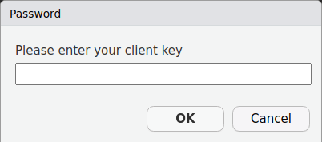
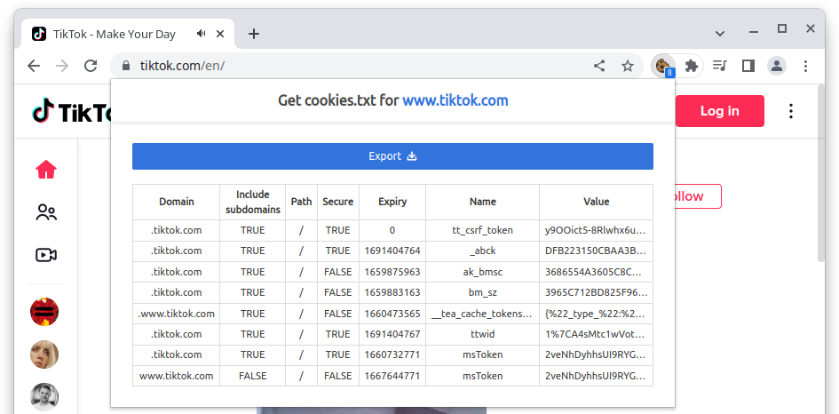

Since social media platform TikTok went live in Europe in August of 2018^[[https://www.theverge.com/2018/8/2/17644260/musically-rebrand-tiktok-bytedance-douyin](https://web.archive.org/web/20231122151117/https://www.theverge.com/2018/8/2/17644260/musically-rebrand-tiktok-bytedance-douyin)], it has quickly become one of the major players on the market.
As of early 2023, TikTok claims to have around 150 million users^[[https://newsroom.tiktok.com/en-eu/investing-for-our-150-m-strong-community-in-europe](https://web.archive.org/web/20231117185422/https://newsroom.tiktok.com/en-eu/investing-for-our-150-m-strong-community-in-europe)], many of which are young and committed to the platform.
For instance, @newman_reuters_2023 positions TikTok as the third most-used platform among 18-24 year olds.
Consequently, the platform's content has been attributed to various societal shifts, notably the increasing support for far-right parties among young voters in recent elections.^[[https://www.nytimes.com/2024/06/10/world/europe/germany-afd-eu-election.html](https://web.archive.org/web/20241003023927/https://www.nytimes.com/2024/06/10/world/europe/germany-afd-eu-election.html)].

Despite TikTok's significant influence, Communication Research has only begun to explore its unique affordances, particularly its combination of video-centric content and algorithmically-driven user feeds [@boeker_empirical_2022].
Initial research has examined how users discuss political issues with each other, finding interesting new dynamic forms of political discourse[@medina_serrano_dancing_2020] and its utilization in political campaigns, which as of recently has still failed to capitalize on the platform’s unique affordances [@cervi_tiktok_2023].

Research challenges stem from both the computational complexity of analyzing video content at scale and limited data access. 
As @cervi_tiktok_2023 note:
"Data have been manually collected by the authors due to the absence of any commercial API for the platform."
While TikTok's 2023 introduction of a Research API has improved this situation by providing qualified researchers with platform access, this access remains both selective and limited in scope.

This tool demo introduced `traktok`, an `R` package that combines an implemenatition of the TikTok Research API with access to TikTok content through web-scraping and the hidden API, which was reverse engeneered to grant users access to more content.
The tool works best for projects where researchers have access to the API, as the content delivered through the API can be enriched with the other functions.
However, even without Research API access, the package enables meaningful data collection through alternative methods.

@tbl-overview gives an overview of all functions in the package.
The following two sections detail the package's functions, categorized by their use of either the Research API or the scarping techniques, dubbed 'hidden' API.
I then showcase how both paths can be combined meaningfully to gather insights into the platorm's content and the shortcomings of the API TikTok ofers to researchers at the moment.

| Description                 | Shorthand        | Research API              | Hidden API              |
|:----------------------------|:-----------------|:--------------------------|:------------------------|
| search videos               | tt_search        | tt_search_api             | tt_search_hidden        |
| get video detail (+file)    | tt_videos        | \-                        | tt_videos_hidden        |
| get user videos             | tt_user_info     | tt_search_api             | tt_user_videos_hidden   |
| get user info               | tt_user_info     | tt_user_info_api          | \-                      |
| get comments under a video  | tt_comments      | tt_comments_api           | \-                      |
| get who follows a user      | tt_get_follower  | tt_user_follower_api      | tt_get_follower_hidden  |
| get who a user is following | tt_get_following | tt_user_following_api     | tt_get_following_hidden |
| get videos a user liked     | tt_get_liked     | tt_user_liked_videos_api  | \-                      |
| get pinned videos of users  | tt_get_pinned    | tt_user_pinned_videos_api | \-                      |
| get videos in a playlist    | tt_playlist      | tt_playlist_api           | \-                      |
| get raw video data          | \-               | \-                        | tt_request_hidden       |
| authenticate a session      | \-               | auth_research             | auth_hidden             |

: Function overview of `traktok`  {#tbl-overview}


# Research API

To get access to TikTok's Research API, researchers must be be eligible^[The [terms are available on TikTok's website for developers](https://developers.tiktok.com/products/research-api)], create a developer account and then apply for access to the research API with a specific research proposal.
If approved, researchers receive a client key and client secret, accesible on their developer account^[<https://developers.tiktok.com/research>].
`traktok` facilitates authentication and stores an encrypted token, which is automatically renewed when going stale.
All the user has to do is run the command below, which start a guided process.

``` r
library(traktok)
auth_research()
```

{#fig-askpass}

Through the use of `askpass` [@askpass], the client key and secret are not stored in the `R` history or script and there is not chance to accidentally upload them to cloud storage or a version control system like Git.
This process usually does not have to be repeated, except when the user requests a client key or secret change from TikTok.

The most useful endpoint that the Research API offers is to search the platform for posts.
For queries, TikTok uses a fine-grained, yet complicated [query syntax](https://developers.tiktok.com/doc/research-api-specs-query-videos#query).
For convenience, a query in `traktok` is constructed internally when you search with a key phrase directly:

``` r
tt_query_videos("#rstats", max_pages = 2L)
#> 
ℹ Making initial request

✔ Making initial request [774ms]
#> 
ℹ Parsing data

✔ Parsing data [177ms]
#> ── search id: NA ───────────────────────────────────────
#> # A tibble: 0 × 13
#> # ℹ 13 variables: video_id <lgl>, author_name <chr>,
#> #   view_count <int>, comment_count <int>,
#> #   share_count <int>, like_count <int>,
#> #   region_code <chr>, create_time <dttm>,
#> #   effect_ids <list>, music_id <chr>,
#> #   video_description <chr>, hashtag_names <list>,
#> #   voice_to_text <chr>
```

This will match a supplied keyword or phrase against keywords and hashtags and return up to 200 results (each page has 100 results and 2 pages are requested by default) from today and yesterday.
Every whitespace is treated as an AND operator.
To extend the data range, you can set a start and end (which can be a maximum of 30 days apart, but there is no limit how far you can go back):


``` r
tt_query_videos("#rstats",
                max_pages = 2L,
                start_date = as.Date("2023-11-01"),
                end_date = as.Date("2023-11-29"))
#> ── search id: 7423432753447932974 ──────────────────────
#> # A tibble: 19 × 13
#>    video_id         author_name view_count comment_count
#>    <chr>            <chr>            <int>         <int>
#>  1 730689385329705… statistics…        909             4
#>  2 730630774458222… learningca…       1104            11
#>  3 730501447636800… picanumeros       4645             8
#>  4 730297066790799… smooth.lea…      98717            17
#>  5 730247037950160… statistics…        508             0
#>  6 730097749816510… statistics…      27387             1
#>  7 730093147605973… rigochando        2603             4
#>  8 730092229522312… elartedeld…        765             0
#>  9 729998705941704… statistics…       1110             1
#> 10 729965751681473… rigochando         905             4
#> 11 729934294487885… rigochando         555             0
#> 12 729896668413454… rigochando        1312             1
#> 13 729691148659145… biofreelan…      19758             7
#> 14 729691148625178… biofreelan…       5763             1
#> 15 729691147878174… biofreelan…       1019             3
#> 16 729668885660947… mrpecners          657             2
#> 17 729651863537426… l_a_kelly          514             5
#> 18 729649864535081… mrpecners          373             0
#> 19 729628884337898… casaresfel…        274             0
#> # ℹ 9 more variables: share_count <int>,
#> #   like_count <int>, region_code <chr>,
#> #   create_time <dttm>, effect_ids <list>,
#> #   music_id <chr>, video_description <chr>,
#> #   hashtag_names <list>, voice_to_text <chr>
```

As said, the query syntax that TikTok uses is a little complicated, as users can chain queries with `AND`, `OR` and `NOT` Boolean operators on a number of fields (`"create_date"`, `"username"`, `"region_code"`, `"video_id"`, `"hashtag_name"`, `"keyword"`, `"music_id"`, `"effect_id"`, and `"video_length"`):

| Operator | Results are returned if...                 |
| -------- | ------------------------------------------ |
| AND      | ...all specified conditions are met        |
| OR       | ...any of the specified conditions are met |
| NOT      | ...the not conditions are not met          |

: Boolean operators as used by TikTok  {#tbl-boolean}

To make this easier to use, `traktok` uses a tidyverse style approach to building queries.
For example, to get to the same query that matches #rstats against keywords and hashtags, you need to build the query like this:


``` r
query() |>                                # start by using query()
  query_or(field_name = "hashtag_name",   # add an OR condition on the hashtag field
           operation = "IN",              # the value should be IN the list of hashtags
           field_values = "rstats") |>    # the hashtag field does not accept the #-symbol
  query_or(field_name = "keyword",        # add another OR condition
           operation = "IN",
           field_values = "#rstats")
#> S3<traktok_query>
#> └─or: <list>
#>   ├─<list>
#>   │ ├─field_name: "hashtag_name"
#>   │ ├─operation: "IN"
#>   │ └─field_values: <list>
#>   │   └─"rstats"
#>   └─<list>
#>     ├─field_name: "keyword"
#>     ├─operation: "IN"
#>     └─field_values: <list>
#>       └─"#rstats"
```

If #rstats is found in either the hashtag or keywords of a video, that video is then returned.
Besides checking for `EQ`ual, users can also use one of the other operations:

| Operation | Results are returned if field_values are...     |
| --------- | ----------------------------------------------- |
| EQ        | equal to the value in the field                 |
| IN        | equal to a value in the field                   |
| GT        | greater than the value in the field             |
| GTE       | greater than or equal to the value in the field |
| LT        | lower than the value in the field               |
| LTE       | lower than or equal to the value in the field   |

: Condition operators as used by TikTok {#tbl-match}

This makes building queries relatively complex, but allows for fine-grained searches in the TikTok data:


``` r
search_df <- query() |>
  query_and(field_name = "region_code",
            operation = "IN",
            field_values = c("JP", "US")) |>
  query_or(field_name = "hashtag_name",
            operation = "EQ", # rstats is the only hashtag
            field_values = "rstats") |>
  query_or(field_name = "keyword",
           operation = "IN", # rstats is one of the keywords
           field_values = "rstats") |>
  query_not(operation = "EQ",
            field_name = "video_length",
            field_values = "SHORT") |>
  tt_search_api(start_date = as.Date("2023-11-01"),
                end_date = as.Date("2023-11-29"))

search_df
#> ── search id: 7423432753447965742 ──────────────────────
#> # A tibble: 2 × 13
#>   video_id          author_name view_count comment_count
#>   <chr>             <chr>            <int>         <int>
#> 1 7296688856609475… mrpecners          657             2
#> 2 7296498645350812… mrpecners          373             0
#> # ℹ 9 more variables: share_count <int>,
#> #   like_count <int>, region_code <chr>,
#> #   create_time <dttm>, effect_ids <list>,
#> #   music_id <chr>, video_description <chr>,
#> #   hashtag_names <list>, voice_to_text <chr>
```

This will return videos posted in the US or Japan, that have "rstats" as the only hashtag or as one of the keywords and have a length of `"MID"`, `"LONG"`, or `"EXTRA_LONG"`.^[
See <https://developers.tiktok.com/doc/research-api-specs-query-videos#condition_fields> for possible values of each field.
]

Instead of searching for videos by keyword or hashtag, the endpoint also allows to query all videos a specific account has posted:

``` r
query() |>
  query_and(field_name = "username",
            operation = "EQ",
            field_values = "kamalahq") |>
  tt_search_api(start_date = as.Date("2024-08-01"),
                end_date = as.Date("2024-08-31"))

#> # A tibble: 99 × 13
#>    video_id           author_name view_count comment_count
#>    <chr>              <chr>            <int>         <int> 
#>  1 74093484933299110… kamalahq       1883658          3599 
#>  2 74090413381314347… kamalahq       2485343          1554 
#>  3 74090184761339118… kamalahq        937485          1100
#>  4 74089979841694466… kamalahq       5093111          5693
#>  5 74089584344412029… kamalahq        982621          2075 
#>  6 74089389886664246… kamalahq       3519123          2596
#>  7 74087545861834048… kamalahq        364593           238
#>  8 74087447709082289… kamalahq        831576           869
#>  9 74087072245345190… kamalahq       1257399          3710
#> 10 74086905194395763… kamalahq        408406          1395 
#> # ℹ 9 more variables: share_count <int>,
#> #   like_count <int>, region_code <chr>,
#> #   create_time <dttm>, effect_ids <list>,
#> #   music_id <chr>, video_description <chr>,
#> #   hashtag_names <list>, voice_to_text <chr>
```

The second useful function that we are highlighting here is `tt_comments_api`.
Using a video ID, it retrieves the full text of user comments, along with useful information about the discussion sctructure, like and reply counts.

``` r
tt_comments_api(video_id = "7409348493329911082")

#> # A tibble: 92 × 7
#>    like_count parent_comment_id   reply_count text    
#>         <int> <chr>                     <int> <chr>   
#>  1       2302 7409348493329911082          47 I've ne…
#>  2       2218 7409348493329911082          62 my rank…
#>  3       1865 7409348493329911082          24 My rank…
#>  4        955 7409348493329911082           9 I inten…
#>  5        808 7409348493329911082          12 Don’t t…
#>  6        604 7409348493329911082           5 This ac…
#>  7        421 7409348493329911082          10 Cooked …
#>  8        320 7409348493329911082          15 my team…
#>  9        301 7409348493329911082           4 MADAM P…
#> 10        265 7409348493329911082           5 Assignm…
#> # ℹ 82 more rows
#> # ℹ 3 more variables: video_id <chr>,
#> #   create_time <int>, id <chr>
#> # ℹ Use `print(n = ...)` to see more rows
```

For many research proects, it will also be of value to determine who a user follows and who they are followed by.
This can be accomplished as shown below:


```r
tt_user_follower_api("kamalahq")
#> i Getting user kamalahq
#> v Got user kamalahq [525ms]
#> i Getting user kamalahq
#> # A tibble: 72 x 3
#>    display_name   username          following_user
#>    <chr>          <chr>             <chr>         
#>  1 FroggyFresh    froggyfresh08     kamalahq      
#>  2 Allan          user125137690791  kamalahq      
#>  3 loralorenzo    loralorenzo       kamalahq      
#>  4 aregahengaweke aregahengaweke    kamalahq      
#>  5 Crystal.K      iam_crystal00     kamalahq      
#>  6 noahtugwo81    noahtugwo81       kamalahq      
#>  7 ree            ree0759           kamalahq      
#>  8 Jim            jimbobaz          kamalahq      
#>  9 ganiyuafeez303 gaotavo007        kamalahq      
#> 10 mosh 2k        user1111552735533 kamalahq      
#> # i 62 more rows

# kamalahq has set the following information to private, leading to this output
tt_user_following_api("kamalahq")
#> i Getting user kamalahq
#> x Getting user kamalahq [257ms]
#> ! This information cannot be returned
#> # A tibble: 0 x 1
#> # i 1 variable: following_user <chr>
```

As @tbl-overview shows, there are several other functions that query the Research API, however, `tt_user_liked_videos_api` and ` tt_user_pinned_videos_api` query information that is opt-in and therefore turned off by the large majority of account, similar to the second example above;
`tt_playlist_api` relates to a feature  of the platform that is not widely used;
and `tt_user_info_api` only returns very basic information about accounts that is usually not meaningful for research.

Importantly, a crucial part of the data, namely the video files themselves, are not accesible through the Research API---even though videos can be downloaded through the official TikTok app.
However, `traktok` users can instead obtain this data through the 'hidden' API, discussed in the next section.

# 'Hidden' API

The unofficial or 'hidden' API is essentially what the TikTok website uses to display you content.
How these endpoints work was discovered through reverse engineering and TikTok might change how these endpoints operate at any moment.
Nevertheless, the approach has been working for more than 2 years, with only minor adaptions of the code.

Most functions work by employing the same browser cookies the website uses to authenticate a user.
To get these cookies into `R`, users can log into their TikTok account (or create a new one) with a browser on their computer and then use tools like [*Get cookies.txt*](https://chrome.google.com/webstore/detail/get-cookiestxt-locally/cclelndahbckbenkjhflpdbgdldlbecc) for Chromium based browsers or [*cookies.txt*](https://addons.mozilla.org/en-US/firefox/addon/cookies-txt/) for Firefox^[As almost all browsers used today are based on one of these, these two suggestions should satisfy all users.].
@fig-cookie shows how the process works on the browser.

{#fig-cookie}

It does not matter if the user downloads all cookies or just the ones specific to TikTok, as we use the `cookiemonster` [@cookiemonster] to store cookies securely and `traktok` sends only the appropriate cookies with its requests.
To read the cookies into a specific encrypted file, simply use:


```r
cookiemonster::add_cookies("tiktok.com_cookies.txt")
```

`traktok` will then access these cookies whenever necessary.

Like in the Research API, users can search for videos, albeit at a slower pace and only within the range of what would be shown in the search on the website..
To get the first two pages of search results (one page has 12 videos), you can use this command:


```r
rstats_df <- tt_search_hidden("#rstats", max_pages = 2)

rstats_df
#> # A tibble: 24 × 20
#>    video_id  video_timestamp     video_url video_length video_title
#>    <chr>     <dttm>              <glue>           <int> <chr>      
#>  1 71151144… 2022-06-30 19:17:53 https://…          135 "R for Beg…
#>  2 72522261… 2023-07-05 07:01:45 https://…           36 "Wow!!! TH…
#>  3 72420686… 2023-06-07 22:05:16 https://…           34 "R GRAPHIC…
#>  4 72134135… 2023-03-22 16:49:12 https://…            6 "R and me …
#>  5 72576898… 2023-07-20 00:23:40 https://…           56 "Pie chart…
#>  6 72999870… 2023-11-10 23:58:21 https://…           51 "Quick R Q…
#>  7 72783048… 2023-09-13 13:40:21 https://…           36 "Quick R Q…
#>  8 73029706… 2023-11-19 00:56:09 https://…          163 "What is c…
#>  9 71670108… 2022-11-17 15:42:56 https://…           58 "Here’s an…
#> 10 72933174… 2023-10-24 00:36:48 https://…            9 "#CapCut #…
#> # ℹ 14 more rows
#> # ℹ 15 more variables: video_diggcount <int>,
#> #   video_sharecount <int>, video_commentcount <int>,
#> #   video_playcount <int>, video_is_ad <lgl>, author_name <chr>,
#> #   author_nickname <chr>, author_followercount <int>,
#> #   author_followingcount <int>, author_heartcount <int>,
#> #   author_videocount <int>, author_diggcount <int>, …
```

This delivers most information researchers might be interested in. 
However, one can obtain some more information, and importantly the video file, using `tt_videos`:


```r
rstats_df2 <- tt_videos(rstats_df$video_url[1:2], save_video = TRUE)

rstats_df2
#> # A tibble: 2 × 19
#>   video_id   video_url video_timestamp     video_length video_title
#>   <glue>     <chr>     <dttm>                     <int> <chr>      
#> 1 711511441… https://… 2022-06-30 19:17:53          135 R for Begi…
#> 2 725222615… https://… 2023-07-05 07:01:45           36 Wow!!! THI…
#> # ℹ 14 more variables: video_locationcreated <chr>,
#> #   video_diggcount <int>, video_sharecount <int>,
#> #   video_commentcount <int>, video_playcount <int>,
#> #   author_username <chr>, author_nickname <chr>,
#> #   author_bio <chr>, download_url <chr>, html_status <int>,
#> #   music <list>, challenges <list>, is_classified <lgl>,
#> #   video_fn <chr>
```

When users are scraping many URLs, the function might fail eventually, due to a poor connection or because TikTok is blocking requests.
It therefore usually makes sense to save progress in a cache directory:

```r
rstats_df3 <- tt_videos(rstats_df$video_url[5:6], cache_dir = "rstats")

list.files("rstats")
#> [1] "7257689890245201153.json" "7299987059417042209.json"
```

Note that the video files are downloaded into the `dir` directory (your working directory by default), independently from the cache directory.
If there are information that users feel are missing from the `data.frame` that `tt_videos` returns, they can also access the raw, unparsed json data using:


```r
rstats_list1 <- tt_request_hidden(rstats_df$video_url[1]) |>
  jsonlite::fromJSON()
```

Parsing the result into a list using `fromJSON`, results in a complex nested list, which users can explore further.
Additionally, the functions `tt_get_follower_hidden`, `tt_get_following_hidden`. and `tt_user_videos_hidden` mimick the behaviour of their Research API counterparts.


# Combining the APIs

As the TikTok Research API does not deliver video or image files, any anlaysis of the content of posts prerequisits an alternative route to accessing these data.
`traktok` enables this access via the function `tt_videos_hidden`.
As an example for combining both APIs, let's say we want to aquire all posts from "kamalahq", the campaign account of presidential candidate Kamala Harris, from August 2024.
We can first search for post URLs using the Research API:

```r
#| eval: false
kamalahq_df <- query() |>
  query_and(field_name = "username",
            operation = "EQ",
            field_values = "kamalahq") |>
  tt_search_api(start_date = as.Date("2024-08-01"),
                end_date = as.Date("2024-08-31"))
```

```{r}
#| eval: false
#| include: false
# saveRDS(kamalahq_df, "kamalahq_df.rds")
kamalahq_df <- readRDS("kamalahq_df.rds")
```

```r
#| eval: false
results_df <- tt_videos_hidden(kamalahq_df$video_id,
                               save_video = TRUE,
                               cache_dir = "kamalahq",
                               dir = "kamalahq")

list.files("kamalahq") |> 
  tools::file_ext() |> 
  table()
#> jpeg json  mp4 
#>   96   99   70 
```

As can be seen, the function downloaded 70 video files and additionally 96 image files, which are now also often shared on the platform, copying one of Instagram's main features.
Additionally, the setting `cache_dir = "kamalahq"` makes sure that each request is saved, so that the user does not have to repeat it if the function fails while quering many videos in sequence.

The second important use case for combining both APIs is to compare them to assess the completeness of results, as has been done for Facebook [@hofacebook2020] and Twitter [@tromble_twitter_2017] in the past.
As mentioned in the introduction, Germany's far right party AFD has managed to build hard to overlook presence on TikTok, and serves as a demonstration case here.
For convenience, `traktok` provides the function `tt_user_videos_api`, which makes queries to the Research API for all videos a user has published:

```{r}
#| eval: false
results_api <- tt_user_videos_api(username = "afdfraktionimbundestag", since = "2020-01-01")
```

The same function also exists for the 'hidden' API:

```{r}
#| eval: false
results_scraping <- tt_user_videos_hidden(username = "afdfraktionimbundestag", 
                                          solve_captchas = TRUE)
```

```{r}
#| include: false
results_api <-      readRDS("comparison/results_api.rds")
results_scraping <- readRDS("comparison/results_scraping.rds")
library(tidyverse)
diff_df <- results_api |> 
  full_join(results_scraping, by = "video_id") |> 
    filter(is.na(create_time) | is.na(video_timestamp)) |>
  mutate(
    available_on = case_when(
      is.na(create_time) ~ "website",
      is.na(video_timestamp) ~ "api"
    ),
    video_time = as.POSIXct(ifelse(is.na(create_time), video_timestamp, create_time)),
    video_url_unformatted = paste0("https://www.tiktok.com/@afdfraktionimbundestag/video/", video_id),
    video_url = glue::glue('<a href="{video_url_unformatted}" target="_blank">Link</a>')
  )
```

This will open a real browser in the background that scrolls down on a specific account site until now more videos can be found.
That will often trigger so-called *CAPTCHA*s, which are small challenges created to test if a human or bot is performing an action on the site.
If that happens, and the argument `solve_captchas` is true, the browser will jump to the foreground, so that a user can solve it and the `traktok` can continue scrolling.

Comparing the results from the Research API and the scraping effort, we see some discrepancies.
The Research API delivered `r nrow(results_api)`, while the 'hidden' API found `r `nrow(results_scraping)` posts.
However, the content is also not as similar as these numbers suggest.
`r sum(diff_df$available_on == "website")` posts were only accessible via the website, while `r sum(diff_df$available_on == "api")` posts were found by the API, but not actually present on the website.
Searching manually for the vidoes not present on the channel page on the website, it turns out that these videos were restricted by TikTok as they contain extreme or age-restricted content.
We currently do not know why the search from the API is incomplete.


# Conclusion

`traktok` provides access to TikTok, a social media platform of growing societal importance, that should be systematically studied by communication researchers.
While it is not the first or only tool to do so, the combination of access methods in one `R` package with an easy-to-understand consistent syntax is built to encourage this research.


\newpage

# References
