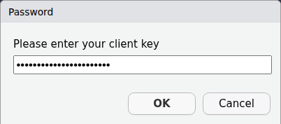
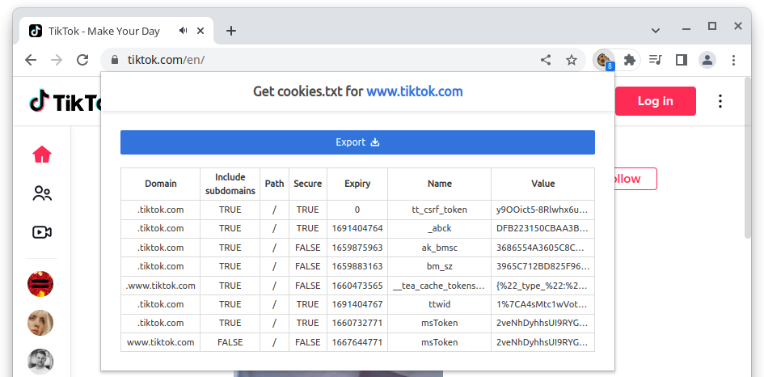

# `traktok` — Making TikTok Data Accessible for Research
Johannes B. Gruber

Since the social media platform TikTok went live in Europe in August
2018[^1], it has quickly become one of the major players on the market.
As of early 2023, TikTok claims to have around 150 million users[^2],
many of whom are young and committed to the platform. For instance,
Newman et al. (2023) positions TikTok as the third most-used platform
among 18-24 year olds. By 2026, over half of them use TikTok weekly and
36% use it for news, second only to Instagram in this age group (Egan et
al. 2026).[^3] Given this reach, it is not surprising that the
platform’s content has been linked to a number of societal shifts, and
the examples that make the headlines are mostly worrying ones: the
increasing support for far-right parties among young voters in recent
elections (Tjaden et al. 2025)[^4], an anti-feminist backlash (Bauer
2024) or the rise of the ‘manosphere’ (Dhoest 2025). But TikTok is also
where established political parties campaign (Widholm et al. 2024),
where news organizations try to reach a young audience (Wirz and Zai
2025), and where activists and ordinary users discuss and negotiate
progressive norms around racism, sexism and homophobia
(Peterson-Salahuddin 2025). Which of these developments dominates, for
whom and under what circumstances, is an empirical question, and the
purpose of `traktok` is to help communication researchers answer it
based on systematic data rather than on the anecdotes that make the
news.

Despite TikTok’s significant influence, Communication Research has only
begun to explore its unique affordances, particularly its combination of
video-centric content and algorithmically driven user feeds (Boeker and
Urman 2022). These affordances have consequences: compared to YouTube, a
larger share of TikTok users upload videos themselves, views depend less
on an account’s number of followers and more on going viral, and
attention is spread more unevenly across the videos of the same account,
which changes the incentives of who produces (political) content and how
(Guinaudeau et al. 2022). Initial research has examined how users
discuss political issues with each other, finding interesting new
dynamic forms of political discourse in duets between partisan users
(Medina Serrano et al. 2020), and its utilization in political
campaigns, where candidates as of recently still failed to capitalize on
the platform’s unique affordances (Cervi et al. 2023). Some of the
content is also genuinely new to political communication: Munger and Li
(2025) study ‘edits’ — highly edited compilations of existing footage of
politicians, set to music, where facticity is beside the point and the
goal is to make the politician look attractive or impressive — and show
experimentally that these videos shift how voters evaluate them. What
these studies have in common is that their data were limited by what
could be collected at the time rather than by their research questions.
Medina Serrano et al. (2020) and Munger and Li (2025) had to rely on
TikTok’s hashtag search, which returns an undisclosed selection of
popular and recent videos, and the `R` package with which Guinaudeau et
al. (2022) collected close to two million videos stopped working after
TikTok implemented an update in late 2020.

Research challenges stem from both the computational complexity of
analysing video content at scale — which I will not address here — and
limited data access. As Cervi et al. (2023) note, they had to search and
collect posts manually, since any official API access was not available
at the time. While TikTok’s 2023 introduction of a Research API has
improved this situation by providing qualified researchers with platform
access, TikTok does not provide tools to work with the API directly and
the access remains both selective and limited in scope. Most
prominently, it is still not possible to download images and videos from
the platform. Yet the video files are worth the effort: Kim et al.
(2023), for example, find that users engage differently with emotional
and identity cues in anti-vaccination videos depending on whether these
appear in the caption, the spoken audio, or the visuals, so that an
analysis of textual metadata alone would miss an important part of how
content on the platform works. This creates a significant barrier for
communication researchers who might possess deep theoretical knowledge
and extensive experience studying other platforms, but lack the
technical programming skills required to directly interface with REST
APIs or implement web-scraping techniques. Without accessible tools,
these researchers — despite their substantive expertise — are
effectively excluded from studying one of the most influential platforms
for youth political engagement and information consumption.

Here I introduce `traktok`, an `R` package that combines an
implementation of the TikTok Research API with access to TikTok content
through web-scraping and the ‘hidden’ API, which was reverse engineered
to grant users access to more content. The tool works best for projects
where researchers have access to the Research API, as the content
delivered through the API can be enriched with the other functions.
However, even without Research API access, the package enables
meaningful data collection through alternative methods. By implementing
both pathways to TikTok data in a single package, `traktok` also enables
researchers to seamlessly perform audits of both data access strategies
against each other, where functions are available for both pathways —
the official and unofficial.

<a href="#tbl-overview" class="quarto-xref">Table 1</a> gives an
overview of all functions in the package. Since some functions are
available for the Research API *and* the ‘hidden’ API, `traktok` offers
some shorthand functions that automatically choose the Research API
function in the background if credentials are available. The following
two sections detail the package’s functions, categorized by their use of
either the Research API or the scraping techniques, dubbed the ‘hidden’
API. I then showcase how both paths can be combined meaningfully to
gather insights into the platform’s content and the shortcomings of the
API TikTok offers to researchers at the moment.

<div id="tbl-overview">

Table 1: Function overview of `traktok`

| Description | Shorthand | Research API | ‘Hidden’ API |
|:---|:---|:---|:---|
| search videos | tt_search | tt_search_api | tt_search_hidden |
| get video detail (+file) | tt_videos | \- | tt_videos_hidden |
| get user videos | tt_user_videos | tt_user_videos_api | tt_user_videos_hidden |
| get user info | tt_user_info | tt_user_info_api | tt_user_info_hidden |
| get comments under a video | tt_comments | tt_comments_api | \- |
| get who follows a user | tt_get_follower | tt_user_follower_api | tt_get_follower_hidden |
| get who a user is following | tt_get_following | tt_user_following_api | tt_get_following_hidden |
| get videos a user liked | tt_get_liked | tt_user_liked_videos_api | \- |
| get videos a user reposted | tt_get_reposted | tt_user_reposted_api | \- |
| get pinned videos of users | tt_get_pinned | tt_user_pinned_videos_api | \- |
| get videos in a playlist | tt_playlist | tt_playlist_api | \- |
| build query objects | query | (query_and, query_or, query_not) | \- |
| get raw post data | tt_json | \- | tt_request_hidden |
| get slideshow posts (+images) | \- | \- | tt_slideshow_hidden |
| retrieve last query/results | last_query, last_comments | \- | \- |
| authenticate a session | \- | auth_research | auth_hidden |

</div>

# Installation

The package can be installed from CRAN (CRAN 2025):

``` r
install.packages("traktok")
```

For the development version, it is also possible to install the package
from GitHub directly[^5].

# Research API

To get access to TikTok’s Research API, researchers must be
eligible[^6], create a developer account and then apply for access to
the research API with a specific research proposal. If approved,
researchers receive a client key and client secret, accessible on their
developer account[^7]. `traktok` facilitates authentication and stores
an encrypted token, which is automatically renewed when going stale
(i.e., expires). All the user has to do is run the command below once,
which starts a guided process. Through the use of `askpass` (Ooms 2024),
the client key and secret are not stored in the `R` history or any
script, but outside the working directory in the user’s cache. That
should make it impossible to accidentally upload confidential
credentials to cloud storage or a version control system like Git. This
process usually does not have to be repeated, except when the user
requests a client key or secret change from TikTok.

``` r
library(traktok)
library(dplyr) # used below to shorten printed output
auth_research()
```

<div id="fig-askpass">



Figure 1: Screenshot of authentication in the RStudio IDE

</div>

The most useful endpoint that the Research API offers is to search the
platform for posts. For queries, TikTok uses a fine-grained, yet
complicated query syntax.[^8] For convenience, a query in `traktok` is
constructed internally when you search with a key phrase directly:

``` r
tt_search_api("#rstats", max_pages = 1L) |>
  head() |> # only print the first six videos
  # drop the usernames of video authors to not print personal information here
  select(-author_name)
#> ── search id: 7711712030692070414 ────────────────────────────────────
#> # A tibble: 5 × 22
#>   video_id            view_count comment_count share_count like_count
#>   <chr>                    <dbl>         <dbl>       <dbl>      <dbl>
#> 1 7708166457800084749       1643             1           4         76
#> 2 7708096706180582676        158             0           0         10
#> 3 7708010960786640160        469             0           0          4
#> 4 7707795585000049951        289             1           0          7
#> 5 7707655558026874120        778             2           2         38
#> # ℹ 17 more variables: favorites_count <dbl>, region_code <chr>,
#> #   create_time <dttm>, video_duration <int>, effect_ids <list>,
#> #   effect_info_list <list>, music_id <chr>, playlist_id <chr>,
#> #   video_description <chr>, hashtag_names <list>,
#> #   hashtag_info_list <list>, video_mention_list <list>,
#> #   sticker_info_list <list>, voice_to_text <chr>,
#> #   is_stem_verified <lgl>, video_label <list>, video_tag <list>
```

This will match a supplied keyword or phrase against keywords and
hashtags, where every white-space is treated as an AND operator, and
return up to 100 results (one page with 100 results is requested by
default; more pages can be requested with `max_pages`) from ten and
eleven days ago (the defaults are `start_date = Sys.Date() - 11` and
`end_date = Sys.Date() - 10`). This somewhat odd default window is
deliberate, as TikTok states that new videos take up to 48 hours to be
added to the search engine behind the Research API and that statistics
such as the view count can take up to 10 days to update.[^9]
Entrena-Serrano et al. (2025) found in their tests that videos were
frequently still missing after 72 hours, so when setting the dates
manually, I recommend leaving a gap of at least three days between the
end date of a query and the day it is run, and of ten days if the
engagement statistics matter for the analysis. To extend the retrieved
range, you can set a start and end date (there is no limit on how far
you can go back):

``` r
tt_search_api(
  "#rstats",
  max_pages = 1L,
  start_date = as.Date("2023-11-01"),
  end_date = as.Date("2023-11-29")
) |>
  head() |> # only print the first six videos
  select(-author_name) # and not the usernames of video authors
#> ── search id: 7711712030692086798 ────────────────────────────────────
#> # A tibble: 6 × 22
#>   video_id            view_count comment_count share_count like_count
#>   <chr>                    <dbl>         <dbl>       <dbl>      <dbl>
#> 1 7306893853297052960        956             3           0         34
#> 2 7306307744582225195       1492            11           0         52
#> 3 7305014476368006433       7742             9          41        280
#> 4 7302970667907992850     100051            19          34       1381
#> 5 7302470379501604128       1585             0           7         36
#> 6 7300977498165103904      27534             3           1        130
#> # ℹ 17 more variables: favorites_count <dbl>, region_code <chr>,
#> #   create_time <dttm>, video_duration <int>, effect_ids <list>,
#> #   effect_info_list <list>, music_id <chr>, playlist_id <chr>,
#> #   video_description <chr>, hashtag_names <list>,
#> #   hashtag_info_list <list>, video_mention_list <list>,
#> #   sticker_info_list <list>, voice_to_text <chr>,
#> #   is_stem_verified <lgl>, video_label <list>, video_tag <list>
```

The API itself only accepts a start and end that are a maximum of 30
days apart, but `traktok` takes care of this in the background: longer
time spans are split into consecutive windows of at most 30 days, which
are queried one after the other before the results are combined. The
returned object also carries the start and end date of the last window
as attributes, so that a search can be picked back up where it stopped
more easily.

As said, the query syntax that TikTok uses is a little complicated, as
users can chain queries with `AND`, `OR` and `NOT` operators (see
<a href="#tbl-boolean" class="quarto-xref">Table 2</a>) on a number of
fields (`"create_date"`, `"username"`, `"region_code"`, `"video_id"`,
`"hashtag_name"`, `"keyword"`, `"music_id"`, `"effect_id"`, and
`"video_length"`).

<div id="tbl-boolean">

Table 2: Boolean operators as used by TikTok

| Operator | Results are returned if…                 |
|----------|------------------------------------------|
| AND      | …all specified conditions are met        |
| OR       | …any of the specified conditions are met |
| NOT      | …the specified conditions are not met    |

</div>

To make queries easier to use, `traktok` uses a tidyverse-style approach
to building a search. For example, to get to the same query we used
above, which matches \#rstats against keywords and hashtags, you need to
build the query like this:

``` r
query() |> # start by using query()
  query_or(
    field_name = "hashtag_name", # add an OR condition on the hashtag field
    operation = "IN", # value should be IN list of hashtags
    field_values = "rstats"
  ) |> # hashtag field does not accept the #-symbol
  query_or(
    field_name = "keyword", # add another OR condition
    operation = "IN",
    field_values = "#rstats"
  )
#> S3<traktok_query>
#> └─or: <list>
#>   ├─<list>
#>   │ ├─field_name: "hashtag_name"
#>   │ ├─operation: "IN"
#>   │ └─field_values: <list>
#>   │   └─"rstats"
#>   └─<list>
#>     ├─field_name: "keyword"
#>     ├─operation: "IN"
#>     └─field_values: <list>
#>       └─"#rstats"
```

<div id="tbl-match">

Table 3: Condition operators as used by TikTok

| Operation | Results are returned if the value in the field is… |
|-----------|----------------------------------------------------|
| EQ        | equal to the value in field_values                 |
| IN        | equal to one of the values in field_values         |
| GT        | greater than the value in field_values             |
| GTE       | greater than or equal to the value in field_values |
| LT        | lower than the value in field_values               |
| LTE       | lower than or equal to the value in field_values   |

</div>

If \#rstats is found in either the hashtag or keywords of a video, that
video is then returned. Besides checking for `EQ`ual, users can also use
one of the other operations shown in
<a href="#tbl-match" class="quarto-xref">Table 3</a>. This makes
building queries relatively complex, but allows for fine-grained
searches in the TikTok data:

``` r
search_df <- query() |>
  query_and(
    field_name = "region_code",
    operation = "IN",
    field_values = c("JP", "US")
  ) |>
  query_or(
    field_name = "hashtag_name",
    operation = "EQ", # rstats is the only hashtag
    field_values = "rstats"
  ) |>
  query_or(
    field_name = "keyword",
    operation = "IN", # rstats is one of the keywords
    field_values = "rstats"
  ) |>
  query_not(
    operation = "EQ",
    field_name = "video_length",
    field_values = "SHORT"
  ) |>
  tt_search_api(
    start_date = as.Date("2023-11-01"),
    end_date = as.Date("2023-11-29")
  )

search_df |>
  select(-author_name) # do not print the usernames of video authors
#> ── search id: 7709396556629300255 ────────────────────────────────────
#> # A tibble: 2 × 12
#>   video_id view_count comment_count share_count like_count region_code
#>   <chr>         <int>         <int>       <int>      <int> <chr>      
#> 1 7296688…        750             2           0          6 US         
#> 2 7296498…        441             0           0          6 US         
#> # ℹ 6 more variables: create_time <dttm>, effect_ids <list>,
#> #   music_id <chr>, video_description <chr>, hashtag_names <list>,
#> #   voice_to_text <chr>
```

This will return videos posted in the US or Japan that have “rstats” as
the only hashtag or as one of the keywords and have a length of `"MID"`,
`"LONG"`, or `"EXTRA_LONG"`.[^10]

Instead of searching for videos by keyword or hashtag, the endpoint also
allows querying all videos a specific account has posted:

``` r
query() |>
  query_and(
    field_name = "username",
    operation = "EQ",
    field_values = "abdulelsayed"
  ) |>
  tt_search_api(
    start_date = as.Date("2026-11-01"),
    end_date = as.Date("2026-11-06")
  ) |>
  head() |> # only print the first six videos
  select(-author_name) # which all come from the queried account anyway
#> ── search id: 7709407382723531806 ────────────────────────────────────
#> # A tibble: 6 × 22
#>   video_id            view_count comment_count share_count like_count
#>   <chr>                    <dbl>         <dbl>       <dbl>      <dbl>
#> 1 7705183301014654239     685349          1383         329      28733
#> 2 7704740245845085470    1349349          2456         427      65011
#> 3 7704310304318049549   34978830        139494      217967    5675229
#> 4 7704309780541705486    3614473          9072        7099     420961
#> 5 7704301976342826253    1711542          1146         541      45691
#> 6 7703701242643483917    2439669          1827        1216      93429
#> # ℹ 17 more variables: favorites_count <dbl>, region_code <chr>,
#> #   create_time <dttm>, video_duration <int>, effect_ids <list>,
#> #   effect_info_list <list>, music_id <chr>, playlist_id <chr>,
#> #   video_description <chr>, hashtag_names <list>,
#> #   hashtag_info_list <list>, video_mention_list <list>,
#> #   sticker_info_list <list>, voice_to_text <chr>,
#> #   is_stem_verified <lgl>, video_label <list>, video_tag <list>
```

As this is a common task, `traktok` also provides the convenience
function `tt_user_videos_api`, which builds this query in the background
and only needs a username and, optionally, a start and end date; I use
it in the section on combining the APIs below.

The second useful function that we are highlighting here is
`tt_comments_api`. Using a video ID, it retrieves the full text of user
comments, along with useful information about the discussion structure,
like and reply counts.

``` r
tt_comments_api(video_id = "7705183301014654239") |>
  head() |> # only print the first six comments
  select(-display_name) # and not the names of commenters
#> # A tibble: 6 × 7
#>   video_id  create_time id    like_count parent_comment_id reply_count
#>   <chr>           <int> <chr>      <int> <chr>                   <int>
#> 1 77051833…  1794003164 7705…        923 7705183301014654…           3
#> 2 77051833…  1794019704 7705…        518 7705183301014654…          21
#> 3 77051833…  1794020395 7705…        418 7705183301014654…           7
#> 4 77051833…  1794003112 7705…        303 7705183301014654…           3
#> 5 77051833…  1794008641 7705…        216 7705183301014654…           1
#> 6 77051833…  1794010898 7705…        211 7705183301014654…           1
#> # ℹ 1 more variable: text <chr>
```

For many research projects, it will also be of value to determine who a
user follows and who they are followed by. This can be accomplished as
shown below:

``` r
# max_pages = 1 is the default
follower_df <- tt_user_follower_api("abdulelsayed", max_pages = 1)
following_df <- tt_user_following_api("abdulelsayed", max_pages = 1)

# the results consist of (user)names, mostly of private individuals,
# so we only print the size and columns of the results here
dim(follower_df)
#> [1] 89  3
colnames(follower_df)
#> [1] "display_name"   "username"       "following_user"
dim(following_df)
#> [1] 96  3
```

As <a href="#tbl-overview" class="quarto-xref">Table 1</a> shows, there
are several other functions that query the Research API. However,
`tt_user_liked_videos_api` and `tt_user_pinned_videos_api` query
information that is opt-in and therefore turned off by the large
majority of accounts; `tt_playlist_api` relates to a feature of the
platform that is not widely used; and `tt_user_info_api` only returns
very basic information about accounts that is usually not meaningful for
research.

Importantly, a crucial part of the data, namely the video files
themselves, is not accessible through the Research API — even though
videos can be downloaded through the official TikTok app. However,
`traktok` users can instead obtain this data through the ‘hidden’ API,
discussed in the next section.

# ‘Hidden’ API

The unofficial or ‘hidden’ API is essentially what the TikTok website
uses to display content. How these endpoints work was discovered through
reverse engineering — that is, studying how the browser retrieves data
to display it and mimicking this behaviour in `R`[^11] — and TikTok
might change how these endpoints operate at any moment. Nevertheless,
the approach has been working since 2022, with only minor adaptations of
the code.

<div id="fig-cookie">



Figure 2: Usage of browser cookies

</div>

All functions of the ‘hidden’ API operate by utilizing the cookies
stored in the browser by the website, allowing requests from `R` to
mimic those from a browser for authentication purposes. HTTP cookies are
small blocks of data websites store in the browser to identify users,
which can range from simple things like remembering your language
preference or items in your shopping cart to more critical functions
like keeping you logged in to your account by storing an authentication
token that verifies your identity with each page you visit. To get these
cookies into `R`, users can log into their TikTok account (or create a
new one) with a browser on their computer and then use tools like [*Get
cookies.txt*](https://chrome.google.com/webstore/detail/get-cookiestxt-locally/cclelndahbckbenkjhflpdbgdldlbecc)
for Chromium-based browsers or
[*cookies.txt*](https://addons.mozilla.org/en-US/firefox/addon/cookies-txt/)
for Firefox[^12]. <a href="#fig-cookie" class="quarto-xref">Figure 2</a>
shows how the process works in the browser. It does not matter if the
user downloads all cookies or just the ones specific to TikTok, as I use
the `cookiemonster` package (Gruber 2023) to store cookies securely and
`traktok` sends only the appropriate cookies with its requests. To read
the cookies into a specific encrypted file, a user only has to run the
following command once:

``` r
auth_hidden("tiktok.com_cookies.txt")
```

A few things about these cookies are worth clarifying. A logged-in
account is not strictly necessary, as TikTok also sets cookies for
visitors who are not logged in, but the website hides some content, such
as age-restricted videos, from these sessions and prompts a login after
a few dozen search results at most, which is why I recommend logging in
before exporting the cookies. Since the cookies identify the account
uniquely, TikTok could in principle link the requests made by `traktok`
to it. As of writing, there are no known incidents of TikTok taking
action against the account of a `traktok` user, but I still recommend
that users rely on throwaway accounts; I return to the legal side of
this in the section on legal and ethical considerations below.

Like in the Research API, users are able to search for videos, albeit at
a slower pace and only within the range of what would be shown in the
search on the website. Technically, the function opens a browser in the
background and keeps scrolling down until there are no more videos found
or until a predefined end time is reached. One caveat is that TikTok
usually interrupts the scrolling with a CAPTCHA at some point, which is
why the example below sets `solve_captchas = TRUE`; I explain what
happens in that case in the section on combining the APIs below. In the
example below, we search for the hashtag “rstats” again and let the
function scroll for two minutes. It is also possible to scroll for an
infinite time, stopping only when no more videos are returned. However,
whether or not an end time is defined, the user can always cancel the
process without losing data. After the function stopped or was stopped,
the URLs of the videos found by the previous search can still be
retrieved with `last_query()`.

``` r
rstats_videos <- tt_search_hidden(
  "#rstats",
  scroll = "2minutes", # stop scrolling after 2 minutes
  solve_captchas = TRUE # open a browser window if a captcha is detected
)
head(rstats_videos)
#> # A tibble: 6 × 26
#>   video_id      video_url video_timestamp     video_length video_title
#>   <chr>         <chr>     <dttm>                     <int> <chr>      
#> 1 763711379646… https://… 2026-05-07 11:42:05           35 "We don’t …
#> 2 725768989024… https://… 2023-07-20 00:23:40           56 "Pie chart…
#> 3 757897673164… https://… 2025-12-01 19:41:20            6 "#datascie…
#> 4 764945181790… https://… 2026-06-09 17:40:23           45 "Personall…
#> 5 755960363056… https://… 2025-10-10 14:43:18           30 "Power Ana…
#> 6 770832792218… https://… 2026-11-15 09:29:01            5 "This is a…
#> # ℹ 21 more variables: video_locationcreated <chr>,
#> #   video_diggcount <int>, video_sharecount <int>,
#> #   video_commentcount <int>, video_playcount <int>, author_id <chr>,
#> #   author_secuid <chr>, author_username <chr>,
#> #   author_nickname <chr>, author_bio <chr>, download_url <chr>,
#> #   html_status <int>, music <list>, challenges <list>,
#> #   video_is_ad <lgl>, is_secret <lgl>, is_for_friend <lgl>, …
# the URLs contain the usernames of video authors, which we mask here
head(last_query()) |>
  sub(pattern = "@[^/]+", replacement = "@user")
#> [1] "https://www.tiktok.com/@user/video/7637113796460350741"
#> [2] "https://www.tiktok.com/@user/video/7257689890245201153"
#> [3] "https://www.tiktok.com/@user/video/7578976731646774541"
#> [4] "https://www.tiktok.com/@user/video/7649451817901755662"
#> [5] "https://www.tiktok.com/@user/video/7559603630563675425"
#> [6] "https://www.tiktok.com/@user/video/7708327922184047904"
```

As with the Research API, we can once again also query the videos posted
by a specific user account. Like `tt_search_hidden`,
`tt_user_videos_hidden` scrolls down the account’s page in a browser in
the background, so the same considerations about the scrolling time and
CAPTCHAs apply, and then collects the data of all posts it found. As the
website offers no way to filter by date, the function cannot be limited
to a time window like the Research API example above; instead, it starts
with the most recent posts and works backwards in time until the
scrolling time is up or the first post of the account is reached:

``` r
abdulelsayed_videos <- tt_user_videos_hidden(
  "abdulelsayed",
  scroll = "2minutes", # stop scrolling after 2 minutes
  solve_captchas = TRUE # open a browser window if a captcha is detected
)
head(abdulelsayed_videos)
#> # A tibble: 6 × 25
#>   video_id      video_url video_timestamp     video_length video_title
#>   <chr>         <chr>     <dttm>                     <int> <chr>      
#> 1 765193506299… https://… 2026-06-16 10:17:48           60 "Today, we…
#> 2 770954923329… https://… 2026-11-18 16:29:26          115 "We haven'…
#> 3 770919916322… https://… 2026-11-17 17:50:48           25 "Donald, t…
#> 4 770886498396… https://… 2026-11-16 20:13:27           16 "I don't p…
#> 5 770851818301… https://… 2026-11-15 21:47:53           49 "If Democr…
#> 6 770816334598… https://… 2026-11-14 22:50:56           53 "The only …
#> # ℹ 20 more variables: video_locationcreated <chr>,
#> #   video_diggcount <int>, video_sharecount <int>,
#> #   video_commentcount <int>, video_playcount <int>, author_id <chr>,
#> #   author_secuid <chr>, author_username <chr>,
#> #   author_nickname <chr>, author_bio <chr>, download_url <chr>,
#> #   html_status <int>, music <list>, challenges <list>,
#> #   is_secret <lgl>, is_for_friend <lgl>, is_slides <lgl>, …
```

Besides their videos, we can also retrieve who follows an account and
whom it follows. The first step is to find out the internal ID of a
user:

``` r
abdulelsayed_info <- tt_user_info_hidden("abdulelsayed")
```

The important piece of information is stored in the column `secUid`,
which we can hand to the `tt_get_follower_hidden` or
`tt_get_following_hidden` function:

``` r
abdulelsayed_following <- tt_get_following_hidden(abdulelsayed_info$secUid)
nrow(abdulelsayed_following)
#> [1] 265
```

For large accounts, this does not deliver the full set of followers or
followed accounts, but only what would be visible on the web version
(the function returns at most 5,000 accounts). It additionally takes
much longer than the Research API version. Therefore, running the
function is only interesting for researchers who do not have access to
the official API.

The most important feature of the ‘hidden’ API, however, which is
interesting also for users who already have access to the Research API,
is to query information about specific posts and to download the videos
or images included in them. This is implemented in the `tt_videos`
function:

``` r
# this comes from a previously saved search
rstats_df <- readRDS("search_results.rds")
rstats_df2 <- tt_videos(rstats_df$video_url[1:2], save_video = TRUE)

rstats_df2
#> # A tibble: 2 × 26
#>   video_id      video_url video_timestamp     video_length video_title
#>   <chr>         <chr>     <dttm>                     <int> <chr>      
#> 1 763711379646… https://… 2026-05-07 11:42:05           35 "We don’t …
#> 2 725768989024… https://… 2023-07-20 00:23:40           56 "Pie chart…
#> # ℹ 21 more variables: video_locationcreated <chr>,
#> #   video_diggcount <int>, video_sharecount <int>,
#> #   video_commentcount <int>, video_playcount <int>, author_id <chr>,
#> #   author_secuid <chr>, author_username <chr>,
#> #   author_nickname <chr>, author_bio <chr>, download_url <chr>,
#> #   html_status <int>, music <list>, challenges <list>,
#> #   is_secret <lgl>, is_for_friend <lgl>, is_slides <lgl>, …
```

When users are scraping many URLs, which in my experience means
thousands rather than hundreds, the function often fails eventually for
one reason or another. It therefore usually makes sense to save progress
in a cache directory:

``` r
rstats_df3 <- tt_videos(rstats_df$video_url[5:6], cache_dir = "rstats")

list.files("rstats")
#> character(0)
```

With this, the package comfortably handles the scale of most research
projects, which I would put somewhere between a handful and around a
hundred thousand videos. I have tested the functions with collections of
about twenty thousand videos, which takes some time, and larger
collections are possible with patience, but industrial-scale scraping of
the platform is not what `traktok` is intended for.

Note that the video files are downloaded into your working directory by
default[^13], independently of the cache directory. `tt_videos` already
retrieves some information that is otherwise not available, like the
`video_status`, which shows a reason when a video is no longer
available. If there is information that users feel is missing from the
`data.frame` that `tt_videos` returns, they can also access the raw,
unparsed JSON data using:

``` r
rstats_list1 <- tt_request_hidden(rstats_df$video_url[1]) |>
  jsonlite::fromJSON()
```

Parsing the result into a list using `fromJSON` results in a complex
nested list, which users can explore further. At the time of writing,
this list contains, for example, the text of stickers placed on the
video, an indicator whether the post is an advertisement, links to
automatically generated subtitles, the follower count of the author and
a label for AI-generated content, none of which are part of the parsed
`data.frame` yet. These fields are candidates to be added to the output
of `tt_videos` in upcoming versions, as I extend the parser whenever
fields turn out to be useful for research. I refrain from documenting
the raw data in more detail, however, as TikTok keeps changing which
fields are available.

# Combining the APIs

As the TikTok Research API does not deliver video or image files, any
analysis of the content of posts requires an alternative route to
accessing these data. `traktok` enables this access via the function
`tt_videos_hidden`. As an example for combining both APIs, let’s say we
want to acquire all posts from “abdulelsayed”, the campaign account of
American politician, epidemiologist, and academic Abdul El-Sayed, who
was elected US Senator in 2026, from the days around the election (1 to
6 November 2026). We can first search for post URLs using the Research
API:

``` r
abdulelsayed_df <- tt_user_videos_api(
  username = "abdulelsayed",
  since = "2026-11-01",
  to = "2026-11-06"
)
```

And then download the video and image files through `tt_videos_hidden`:

``` r
results_df <- tt_videos_hidden(
  abdulelsayed_df$video_id,
  save_video = TRUE,
  cache_dir = "abdulelsayed",
  dir = "abdulelsayed",
  slideshows = TRUE
)

list.files("abdulelsayed") |>
  tools::file_ext() |>
  table()
#> < table of extent 0 >
```

As can be seen, the function downloaded 0 video files and additionally 0
image files, which are now also often shared on the platform, copying
one of Instagram’s main features. These image files belong to so-called
slideshows or photo posts, for which TikTok has recently stopped
including the data in the page source that `tt_videos_hidden` reads.
`traktok` therefore recognises slideshows among the URLs and, once all
other posts are collected, asks whether to hand them to
`tt_slideshow_hidden` (or does so directly with `slideshows = TRUE`),
which opens each post in a browser in the background, waits until the
site has requested the post data itself and collects the metadata and
images from there. As the audio track is often as important for
understanding these posts as the images, the function also downloads the
music of a slideshow as an mp3 file next to the images. Since the cache
was set to the same folder, we also get the raw data as JSON files. This
has the side effect that already downloaded data is not requested again,
if we rerun the function, for example, with an extended list of video
IDs.

The second important use case for combining both APIs is to compare them
to assess the completeness of results, as has been done for Facebook (Ho
2020) and Twitter (Tromble et al. 2017) in the past. As mentioned in the
introduction, Germany’s far-right party AfD has managed to build a
hard-to-overlook presence on TikTok, and serves as a demonstration case
here. For this, we can use the convenience function `tt_user_videos_api`
mentioned above, which makes queries to the Research API for all videos
a user has published:

``` r
results_api <- tt_user_videos_api(
  username = "afdfraktionimbundestag",
  since = "2020-01-01"
)
```

Its counterpart for the ‘hidden’ API is `tt_user_videos_hidden`, which
we already used above:

``` r
results_scraping <- tt_user_videos_hidden(
  username = "afdfraktionimbundestag",
  solve_captchas = TRUE,
  scroll = Inf
)
```

This will open a real browser in the background that scrolls down on a
specific account site until the beginning of a user’s timeline is
reached. This process will often trigger so-called *CAPTCHA*s, which are
small challenges created to test if a human or bot is performing an
action on the site. If that happens, and the argument `solve_captchas`
is true, the browser will jump to the foreground, so that a user can
solve it and `traktok` can continue scrolling.

Comparing the results from the Research API and the scraping effort, we
see some discrepancies. The Research API delivered 308 posts, while the
‘hidden’ API found 319 posts.[^14] However, the content is also not as
similar as these numbers suggest. In total, 15 posts were only
accessible via the website, while 4 posts were found by the API, but not
actually present on the website. Searching manually for the videos not
present on the channel page on the website, it turns out that these
videos were restricted by TikTok as they contain extreme or
age-restricted content — which can also be obtained through the ‘hidden’
API by logging in as an age-verified user. We currently do not know why
the search from the API is incomplete (I come back to this in the final
section).

# Legal and ethical considerations

Studying TikTok comes with some important legal and ethical
considerations, which researchers should keep in mind. First, when
collecting data via APIs or web scraping, researchers must navigate data
privacy regulations, particularly the General Data Protection Regulation
(GDPR) in Europe and similar frameworks globally which protect personal
data of users (European Union 2016). As posts on TikTok often contain
such personal data, `traktok` users usually need to familiarize
themselves with what they can and cannot do with the data they obtain.
One option to legally acquire and share the data would be to obtain
informed consent from the persons who appear in posts (Breuer et al.
2025). Yet, collecting public data in bulk makes individual consent
impractical (Ohme et al. 2024). There are certain exceptions for
research on systemic risks, which mandate additional requirements for
the research pipeline, especially data minimization principles though —
that is, collecting only data necessary for addressing specific research
questions (Breuer et al. 2025). Preprocessing steps to remove personally
identifiable information before analysis are essential (Ohme et al.
2024), though even seemingly anonymous data like follower counts with
timestamps can enable re-identification (Williams et al. 2017). For
`traktok` users, this means deciding before the collection which of the
returned fields a research question actually requires and discarding the
rest: the `data.frame` returned by `tt_videos`, for instance, contains
the usernames, display names and biographies of authors, which many
analyses do not need, and the cache directory and the downloaded video
files contain the complete, unprocessed data, which should be stored
securely and deleted once they have served their purpose.

Secondly, platform-centric methods like scraping public content operate
in a legally ambiguous space: while cases like *hiQ Labs v. LinkedIn* in
the United States have upheld the legality of scraping publicly
accessible data without breaching technological barriers (German Data
Forum (RatSWD) 2020), researchers must still try to respect platform
Terms of Service and consider that users may not be aware their public
data can be used for research (Breuer et al. 2025). The two ways of
accessing TikTok described above differ in this respect: the Research
API is an official channel, whose terms researchers accept when they
apply for access, whereas the ‘hidden’ API needs to be considered
scraping, and TikTok’s Terms of Service prohibit extracting data from
the platform with automated software that TikTok has not approved.[^15]

Brown et al. (2025) review the case law for the United States and
conclude that the legal risk is lowest when researchers collect only
what is publicly accessible without an account and do not circumvent
technical barriers, and that it is higher when data are collected
through an account, as the ‘hidden’ API functions of `traktok` can do,
since the account holder has agreed to the terms and the platform can
withdraw its permission at any time, for example by blocking the
account. A breach of the Terms of Service alone is not a criminal
offence in the United States and the platform would have to demonstrate
actual harm, which is difficult in the case of non-commercial research
(Brown et al. 2025), but even though unlikely, legal dispute is costly
and, as Brown et al. (2025) point out, a university’s legal department
represents the university rather than the individual researcher.

I therefore recommend that users consult their institution’s legal
counsel and data protection officer before collecting data at scale with
the ‘hidden’ API, and clarify at the same time whether the institution
would support them should TikTok take action against them. Zero legal
risk is not attainable in this area, and excessive caution comes at the
cost of research that is in the public interest (Brown et al. 2025),
which is why `traktok` is built to stay within what a regular user could
do in a browser: the functions of the ‘hidden’ API wait a random
interval between requests (see the `sleep_pool` argument), which keeps
the pace of requests, and thereby the load on TikTok’s servers, close to
that of a human user, and when the site asks for a CAPTCHA, the browser
is handed to the user rather than the challenge being circumvented.

Thirdly, the Digital Services Act (DSA) in the European Union introduces
new provisions mandating platforms to provide data access to qualified
researchers (Ausloos and Veale 2021), potentially reducing dependency on
platform cooperation and legally and ethically ambiguous data collection
methods. However, implementation details and enforcement mechanisms
remain evolving. Finally, researchers should consider the ethical
implications of studying vulnerable populations, particularly given
TikTok’s young user base, and the potential harms from analyzing
sensitive content without appropriate safeguards (Breuer et al. 2025).
Questions like these are what institutional ethics boards are for, and I
recommend involving them early, before a collection has started, rather
than after the fact (Brown et al. 2025).

# Current status and future

`traktok` provides access to TikTok, a social media platform of growing
societal importance, which should be systematically studied by
communication researchers. While it is not the first or only tool to do
so, the combination of access through the Research API and web scraping
methods in one `R` package with an easy-to-understand consistent syntax
is built to encourage this research.

Several studies have used the package already to make important
contributions. In communication research, Wirz et al. (2023) studied the
posts of news organizations on TikTok compared with the same outlets’
websites and found high-quality news reporting, albeit with more focus
on emotional and soft news. Similarly, Wirz and Zai (2025) studied
Instagram and TikTok content by news companies, finding that many
outlets still share high-quality news content, peppered with some more
entertainment. Hohner et al. (2024) studied mobilization strategies of
far-right groups on TikTok and found distinct communication strategies
like using conspiracy narratives and anti-elitism. Widholm et al. (2024)
studied election campaign videos in Sweden, revealing that youth
organizations had the most prominent accounts and that right-wing
content resulted in more engagement. Peterson-Salahuddin (2025) found
that “TikTok’s predominantly Gen-Z users engage the platform to discuss,
negotiate, and put in place socially progressive norms around racism,
sexism, and homophobia” (p. 430).

But also beyond communication research, the package has already been
employed for important contributions. In medicine, Blakeman et al.
(2025) studied posts with health-related information on Twitter (X),
Instagram, and, using `traktok`, also TikTok. Donaldson et al. (2025)
studied how especially young users discuss nicotine pouches on TikTok,
with the result that many videos featured pro-tobacco themes.

The discrepancy between the Research API and the website that I showed
in the section on combining the APIs also deserves a closer look, as it
is not a quirk of my example but has by now been confirmed at a larger
scale. Pearson et al. (2025) audited the API against the website and
likewise found publicly available videos that the API did not return,
along with view counts that were, for data collected before July 2024,
orders of magnitude lower than those displayed on the website and errors
when filtering by username; Corso et al. (2024) obtained at most 65% of
the videos they requested when drawing a random sample over six years;
and Entrena-Serrano et al. (2025) found that one in eight videos in a
donated dataset of around 260,000 posts were publicly available on the
website but not retrievable through the API. TikTok has not explained
these gaps, but the audits allow for informed assumptions: besides
deleted and private videos, which the documentation mentions, the API
withholds advertisements, videos posted by TikTok itself, everything by
creators it locates in Canada and, for no apparent reason, some accounts
altogether, while a share of the missing videos remains unexplained
(Entrena-Serrano et al. 2025). For researchers this means that the
Research API should not be mistaken for a complete record and that
scraping the website remains the only way to check what it delivers,
which is a second reason for keeping both routes in one package.

As noted above, TikTok can change the endpoints behind the ‘hidden’ API
at any time, and there is no guarantee that the Research API stays as it
is either. I therefore intend to keep maintaining `traktok` for the
foreseeable future: development happens openly in the GitHub
repository[^16], where users can report problems and contribute fixes,
and stable versions are published on CRAN (the Comprehensive R Archive
Network). Should I at some point be unable to continue this work, which
I consider unlikely, I will look for a successor and hand the package
over to a new maintainer or organization rather than let it go stale.



# References

<div id="refs" class="references csl-bib-body hanging-indent">

<div id="ref-ausloos_researching_2021" class="csl-entry">

Ausloos, Jef, and Michael Veale. 2021. “Researching with Data Rights.”
*Technology and Regulation* 2020 (January): 136–57.
<https://doi.org/10.71265/sfcgjr17>.

</div>

<div id="ref-bauer_beauty_2024" class="csl-entry">

Bauer, Mareike Fenja. 2024. “Beauty, Baby and Backlash? Anti-Feminist
Influencers on TikTok.” *Feminist Media Studies* 24 (5): 1023–41.
<https://doi.org/10.1080/14680777.2023.2263820>.

</div>

<div id="ref-blakeman_describing_2025" class="csl-entry">

Blakeman, John R., Nathan Carpenter, and Susana J. Calderon. 2025.
“Describing Acute Coronary Syndrome Symptom Information on Social Media
Platforms.” *Heart & Lung* 70 (March): 112–21.
<https://doi.org/10.1016/j.hrtlng.2024.11.021>.

</div>

<div id="ref-boeker_empirical_2022" class="csl-entry">

Boeker, Maximilian, and Aleksandra Urman. 2022. “An Empirical
Investigation of Personalization Factors on TikTok.” *Proceedings of the
ACM Web Conference 2022* (New York, NY, USA), WWW ’22, April, 2298–309.
<https://doi.org/10.1145/3485447.3512102>.

</div>

<div id="ref-breuer_overview_2025" class="csl-entry">

Breuer, Johannes, Sebastian Stier, Josephine Lukito, Frank Mangold,
Mareike Wieland, and Danica Radovanović. 2025. *Overview of Ethical
Considerations When Working with Digital Behavioral Data (GESIS Guides
to Digital Behavioral Data, 14)*. GESIS - Leibniz-Institute for the
Social Sciences. <https://doi.org/10.60762/GGDBD25014.1.0>.

</div>

<div id="ref-brown_web_2025" class="csl-entry">

Brown, Megan A, Andrew Gruen, Gabe Maldoff, Solomon Messing, Zeve
Sanderson, and Michael Zimmer. 2025. “Web Scraping for Research: Legal,
Ethical, Institutional, and Scientific Considerations.” *Big Data &
Society* 12 (4): 20539517251381686.
<https://doi.org/10.1177/20539517251381686>.

</div>

<div id="ref-cervi_tiktok_2023" class="csl-entry">

Cervi, Laura, Santiago Tejedor, and Fernando García Blesa. 2023. “TikTok
and Political Communication: The Latest Frontier of Politainment? A Case
Study.” *Media and Communication* 11 (2).
<https://doi.org/10.17645/mac.v11i2.6390>.

</div>

<div id="ref-corso_what_2024" class="csl-entry">

Corso, Francesco, Francesco Pierri, and Gianmarco De Francisci Morales.
2024. “What We Can Learn from TikTok Through Its Research API.”
*Companion Proceedings of the 16th ACM Web Science Conference*, May,
110–14. <https://doi.org/10.1145/3630744.3663611>.

</div>

<div id="ref-cran" class="csl-entry">

CRAN. 2025. *The Comprehensive R Archive Network*. R Foundation for
Statistical Computing. <https://CRAN.R-project.org/>.

</div>

<div id="ref-dhoest_manosphere_2025" class="csl-entry">

Dhoest, Alexander. 2025. “From Manosphere to Mainstream: Representations
of Masculinity on TikTok.” *International Journal of Communication* 19
(May): 2201–20. <https://ijoc.org/index.php/ijoc/article/view/24706>.

</div>

<div id="ref-donaldson_describing_2025" class="csl-entry">

Donaldson, Scott I, Kathryn La Capria, Amanda DeJesus, Ollie Ganz,
Cristine D Delnevo, and Jon-Patrick Allem. 2025. “Describing ZYN-Related
Content on TikTok: Content Analysis.” *Nicotine and Tobacco Research*,
January, ntaf016. <https://doi.org/10.1093/ntr/ntaf016>.

</div>

<div id="ref-egan_reuters_2026" class="csl-entry">

Egan, Jim, Craig T. Robertson, Amy Ross Arguedas, et al. 2026. *Reuters
Institute Digital News Report 2026*. Reuters Institute for the Study of
Journalism. <https://doi.org/10.60625/risj-4vgf-s811>.

</div>

<div id="ref-entrena-serrano_tiktoks_2025" class="csl-entry">

Entrena-Serrano, Carlos, Martin Degeling, Salvatore Romano, and Raziye
Buse Çetin. 2025. *TikTok’s Research API: Problems Without
Explanations*. arXiv. <https://doi.org/10.48550/arXiv.2506.09746>.

</div>

<div id="ref-european_union_regulation_2016" class="csl-entry">

European Union. 2016. “Regulation (EU) 2016/679 of the European
Parliament and of the Council of 27 April 2016 on the Protection of
Natural Persons with Regard to the Processing of Personal Data and on
the Free Movement of Such Data, and Repealing Directive 95/46/EC
(General Data Protection Regulation).” In *Official Journal of the
European Union*. <https://eur-lex.europa.eu/eli/reg/2016/679/oj>.

</div>

<div id="ref-ratswd_big_2020" class="csl-entry">

German Data Forum (RatSWD). 2020. “Big Data in Social, Behavioural, and
Economic Sciences: Data Access and Research Data Management.” In *RatSWD
Output Paper Series*. <https://doi.org/10.17620/02671.52>.

</div>

<div id="ref-cookiemonster" class="csl-entry">

Gruber, Johannes B. 2023. *<span class="nocase">cookiemonster</span>:
Your Friendly Solution to Managing Browser Cookies in R*.
<https://github.com/JBGruber/cookiemonster>.

</div>

<div id="ref-guinaudeau_fifteen_2022" class="csl-entry">

Guinaudeau, Benjamin, Kevin Munger, and Fabio Votta. 2022. “Fifteen
Seconds of Fame: TikTok and the Supply Side of Social Video.”
*Computational Communication Research* 4 (2): 463–85.
<https://doi.org/10.5117/ccr2022.2.004.guin>.

</div>

<div id="ref-hofacebook2020" class="csl-entry">

Ho, Justin Chun-Ting. 2020. “How Biased Is the Sample? Reverse
Engineering the Ranking Algorithm of Facebook’s Graph Application
Programming Interface.” *Big Data & Society* 7 (1): 2053951720905874.
<https://doi.org/10.1177/2053951720905874>.

</div>

<div id="ref-hohner_analysing_2024" class="csl-entry">

Hohner, Julian, Azade Esther Kakavand, and Sophia Rothut. 2024.
“Analyzing Radical Visuals at Scale: How Far-Right Groups Mobilize on
TikTok.” *Journal of Digital Social Research* 6 (1).
<https://doi.org/10.33621/jdsr.v6i1.200>.

</div>

<div id="ref-kim_going_2023" class="csl-entry">

Kim, Sang Jung, Isabel Iruani Villanueva, and Kaiping Chen. 2023. “Going
Beyond Affective Polarization: How Emotions and Identities Are Used in
Anti-Vaccination TikTok Videos.” *Political Communication* 41 (4):
588–607. <https://doi.org/10.1080/10584609.2023.2243852>.

</div>

<div id="ref-medina_serrano_dancing_2020" class="csl-entry">

Medina Serrano, Juan Carlos, Orestis Papakyriakopoulos, and Simon
Hegelich. 2020. “Dancing to the Partisan Beat: A First Analysis of
Political Communication on TikTok.” *12th ACM Conference on Web Science*
(Southampton United Kingdom), July, 257–66.
<https://doi.org/10.1145/3394231.3397916>.

</div>

<div id="ref-munger_thirst_2025" class="csl-entry">

Munger, Kevin, and Valerie Li. 2025. “Thirst Traps and Quick Cuts: The
Effects of TikTok ‘Edits’ on Evaluations of Politicians.” *Social
Media + Society* 11 (2): 20563051251329990.
<https://doi.org/10.1177/20563051251329990>.

</div>

<div id="ref-newman_reuters_2023" class="csl-entry">

Newman, Nic, Richard Fletcher, Kirsten Eddy, Craig T. Robertson, and
Rasmus Kleis Nielsen. 2023. *Reuters Institute Digital News Report
2023*. Reuters Institute for the Study of Journalism.
<https://doi.org/10.60625/risj-p6es-hb13>.

</div>

<div id="ref-ohme_digital_2024" class="csl-entry">

Ohme, Jakob, Theo Araujo, Laura Boeschoten, et al. 2024. “Digital Trace
Data Collection for Social Media Effects Research: APIs, Data Donation,
and (Screen) Tracking.” *Communication Methods and Measures* 18 (2):
124–41. <https://doi.org/10.1080/19312458.2023.2181319>.

</div>

<div id="ref-askpass" class="csl-entry">

Ooms, Jeroen. 2024. *<span class="nocase">askpass</span>: Password Entry
Utilities for R, Git, and SSH*.
<https://CRAN.R-project.org/package=askpass>.

</div>

<div id="ref-pearson_tiktok_api_2025" class="csl-entry">

Pearson, George D. H., Nathan A. Silver, Jessica Y. Robinson, Mona
Azadi, Barbara A. Schillo, and Jennifer M. Kreslake. 2025. “Beyond the
Margin of Error: A Systematic and Replicable Audit of the TikTok
Research API.” *Information, Communication & Society* 28 (3): 452–70.
<https://doi.org/10.1080/1369118x.2024.2420032>.

</div>

<div id="ref-peterson-salahuddin_teachable_2025" class="csl-entry">

Peterson-Salahuddin, Chelsea. 2025. “Teachable Moments: TikTok Social
Drama as a Site of Black Feminist Intellectual Production.”
*Information, Communication & Society* 28 (3): 417–34.
<https://doi.org/10.1080/1369118X.2024.2388093>.

</div>

<div id="ref-tjaden_does_2025" class="csl-entry">

Tjaden, Jasper, Johannes Wolfgram, Aaron Philipp, et al. 2025. *Does the
TikTok Feed Lean Right? Exposure to Political Party Content Among
Non-Partisan Users During Regional and Federal Elections in Germany*.
<https://doi.org/10.31235/osf.io/7vdex_v1>.

</div>

<div id="ref-tromble_twitter_2017" class="csl-entry">

Tromble, Rebekah, Andreas Storz, and Daniela Stockmann. 2017. “We Don’t
Know What We Don’t Know: When and How the Use of Twitter’s Public APIs
Biases Scientific Inference.” *SSRN Electronic Journal*, ahead of print.
<https://doi.org/10.2139/ssrn.3079927>.

</div>

<div id="ref-widholm_right-wing_2024" class="csl-entry">

Widholm, Andreas, Mattias Ekman, and Anders Olof Larsson. 2024. “A
Right-Wing Wave on TikTok? Ideological Orientations, Platform Features,
and User Engagement During the Early 2022 Election Campaign in Sweden.”
*Social Media + Society* 10 (3): 20563051241269266.
<https://doi.org/10.1177/20563051241269266>.

</div>

<div id="ref-williams_towards_2017" class="csl-entry">

Williams, Matthew L., Pete Burnap, and Luke Sloan. 2017. “Towards an
Ethical Framework for Publishing Twitter Data in Social Research: Taking
into Account Users’ Views, Online Context and Algorithmic Estimation.”
*Sociology* 51 (6): 1149–68. <https://doi.org/10.1177/0038038517708140>.

</div>

<div id="ref-wirz_infotainment_2025" class="csl-entry">

Wirz, Dominique S., and Florin Zai. 2025. “Infotainment on Social Media:
How News Companies Combine Information and Entertainment in News Stories
on Instagram and TikTok.” *Digital Journalism* 13 (7): 1249–70.
<https://doi.org/10.1080/21670811.2025.2464062>.

</div>

<div id="ref-wirz_qualitat_2023" class="csl-entry">

Wirz, Dominique S., Florin Zai, Daniel Vogler, Aleksandra Urman, and
Mark Eisenegger. 2023. *Die Qualität von Schweizer Medien Auf Instagram
Und TikTok*. <https://doi.org/10.5167/UZH-238605>.

</div>

</div>

[^1]: [https://www.theverge.com/2018/8/2/17644260/musically-rebrand-tiktok-bytedance-douyin](https://web.archive.org/web/20231122151117/https://www.theverge.com/2018/8/2/17644260/musically-rebrand-tiktok-bytedance-douyin)

[^2]: [https://newsroom.tiktok.com/en-eu/investing-for-our-150-m-strong-community-in-europe](https://web.archive.org/web/20231117185422/https://newsroom.tiktok.com/en-eu/investing-for-our-150-m-strong-community-in-europe)

[^3]: The 2024 and 2025 editions of the Digital News Report do not
    report platform use among 18-24 year olds in this form.

[^4]: [https://www.nytimes.com/2024/06/10/world/europe/germany-afd-eu-election.html](https://web.archive.org/web/20241003023927/https://www.nytimes.com/2024/06/10/world/europe/germany-afd-eu-election.html)

[^5]: <https://github.com/JBGruber/traktok>

[^6]: The terms are available on TikTok’s website for developers at
    <https://developers.tiktok.com/products/research-api>.

[^7]: More information is provided by TikTok at
    <https://developers.tiktok.com/research>.

[^8]: See
    <https://developers.tiktok.com/doc/research-api-specs-query-videos#query>.

[^9]: See <https://developers.tiktok.com/doc/research-api-faq>.

[^10]:  See
    <https://developers.tiktok.com/doc/research-api-specs-query-videos#condition_fields>
    for possible values of each field.

[^11]: The groundwork for this was done by Deen Freelon and his pyktok
    Python package.

[^12]: As almost all browsers used today are based on one of these,
    these two suggestions should satisfy all users.

[^13]: Can be controlled with the `dir` argument in `tt_videos`.

[^14]: This analysis was conducted on 31 October 2024.

[^15]: See the section “What you can’t do on the Platform” in the terms
    for the European Economic Area,
    <https://www.tiktok.com/legal/page/eea/terms-of-service/en>; the
    terms for the United States,
    <https://www.tiktok.com/legal/page/us/terms-of-service/en>, contain
    the same clause.

[^16]: <https://github.com/JBGruber/traktok>
