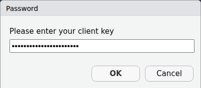
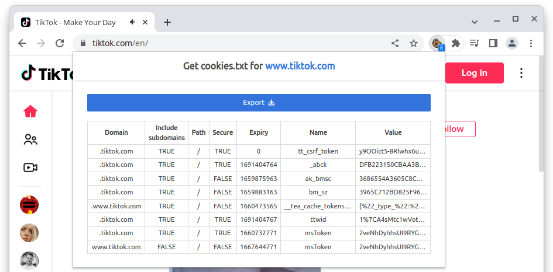

Since the social media platform TikTok went live in Europe in August 2018^[[https://www.theverge.com/2018/8/2/17644260/musically-rebrand-tiktok-bytedance-douyin](https://web.archive.org/web/20231122151117/https://www.theverge.com/2018/8/2/17644260/musically-rebrand-tiktok-bytedance-douyin)], it has quickly become one of the major players on the market.
As of early 2023, TikTok claims to have around 150 million users^[[https://newsroom.tiktok.com/en-eu/investing-for-our-150-m-strong-community-in-europe](https://web.archive.org/web/20231117185422/https://newsroom.tiktok.com/en-eu/investing-for-our-150-m-strong-community-in-europe)], many of which are young and committed to the platform.
For instance, @newman_reuters_2023 positions TikTok as the third most-used platform among 18-24 year olds.
Consequently, the platform's content has been attributed to various societal shifts, notably the increasing support for far-right parties among young voters in recent elections^[[https://www.nytimes.com/2024/06/10/world/europe/germany-afd-eu-election.html](https://web.archive.org/web/20241003023927/https://www.nytimes.com/2024/06/10/world/europe/germany-afd-eu-election.html)], an anti-feminist backlash [@bauer_beauty_2024], rise of the 'manosphere' [@dhoest_manosphere_2025].

Despite TikTok's significant influence, Communication Research has only begun to explore its unique affordances, particularly its combination of video-centric content and algorithmically-driven user feeds [@boeker_empirical_2022].
Initial research has examined how users discuss political issues with each other, finding interesting new dynamic forms of political discourse [@medina_serrano_dancing_2020] and its utilization in political campaigns, which as of recently has still failed to capitalize on the platform’s unique affordances [@cervi_tiktok_2023].

Research challenges stem from both the computational complexity of analysing video content at scale and limited data access.
As @cervi_tiktok_2023 note, they had to search and collect posts manually, since any official API access was not available at the time.
While TikTok's 2023 introduction of a Research API has improved this situation by providing qualified researchers with platform access, they do not provide tools to work with the API directly and the access remains both selective and limited in scope.
This creates a significant barrier for communication researchers who might possess deep theoretical knowledge and extensive experience studying other platforms, but lack the technical programming skills required to directly interface with REST APIs or implement web-scraping techniques.
Without accessible tools, these researchers --- despite their substantive expertise --- are effectively excluded from studying one of the most influential platforms for youth political engagement and information consumption.

Here I introduce `traktok`, an `R` package that combines an implementation of the TikTok Research API with access to TikTok content through web-scraping and the 'hidden' API, which was reverse engineered to grant users access to more content.
The tool works best for projects where researchers have access to the Research API, as the content delivered through the API can be enriched with the other functions.
However, even without Research API access, the package enables meaningful data collection through alternative methods.
By implementing both pathways to TikTok data in a single package, `traktok` also enables researchers to seamlessly perform audits of both data access strategies against each other, where functions are available for both pathways --- the official and unofficial.

@tbl-overview gives an overview of all functions in the package.
Since some functions are available for the Research API *and* the 'hidden' API, `traktok` offers some shorthand functions which automatically chooses the Research API function in the background if credentials are available.
The following two sections detail the package's functions, categorized by their use of either the Research API or the scarping techniques, dubbed 'hidden' API.
I then showcase how both paths can be combined meaningfully to gather insights into the platform's content and the shortcomings of the API TikTok offers to researchers at the moment.

| Description                 | Shorthand        | Research API              | 'Hidden' API              |
|:----------------------------|:-----------------|:--------------------------|:------------------------|
| search videos               | tt_search        | tt_search_api             | tt_search_hidden        |
| get video detail (+file)    | tt_videos        | \-                        | tt_videos_hidden        |
| get user videos             | tt_user_videos   | tt_user_videos_api        | tt_user_videos_hidden   |
| get user info               | tt_user_info     | tt_user_info_api          | tt_user_info_hidden     |
| get comments under a video  | tt_comments      | tt_comments_api           | \-                      |
| get who follows a user      | tt_get_follower  | tt_user_follower_api      | tt_get_follower_hidden  |
| get who a user is following | tt_get_following | tt_user_following_api     | tt_get_following_hidden |
| get videos a user liked     | tt_get_liked     | tt_user_liked_videos_api  | \-                      |
| get videos a user reposted  | tt_get_reposted  | tt_user_reposted_api      | \-                      |
| get pinned videos of users  | tt_get_pinned    | tt_user_pinned_videos_api | \-                      |
| get videos in a playlist    | tt_playlist      | tt_playlist_api           | \-                      |
| build query objects         | query            | (query_and, query_or, query_not) | \-               |
| get raw post data           | tt_json          | \-                        | tt_request_hidden       |
| retrieve last query/results | last_query, last_comments | \-               | \-                      |
| authenticate a session      | \-               | auth_research             | auth_hidden             |

: Function overview of `traktok` {#tbl-overview}

# Installation

The package can be installed from CRAN (@cran):

```r
install.packages("traktok")
```

For the development version, it is also possible to install the package from GitHub directly.

# Research API

To get access to TikTok's Research API, researchers must be eligible^[The terms are available on TikTok's website for developers at <https://developers.tiktok.com/products/research-api>.], create a developer account and then apply for access to the research API with a specific research proposal.
If approved, researchers receive a client key and client secret, accessible on their developer account^[More information is provided by TikTok at <https://developers.tiktok.com/research>.].
`traktok` facilitates authentication and stores an encrypted token, which is automatically renewed when going stale (i.e., expires).
All the user has to do is run the command below once, which starts a guided process.
Through the use of `askpass` [@askpass], the client key and secret are not stored in the `R` history or any script, but outside the working directory in the users cache.
That should make it impossible to accidentally upload confidential credentials to cloud storage or a version control system like Git.
This process usually does not have to be repeated, except when the user requests a client key or secret change from TikTok.

``` r
library(traktok)
auth_research()
```

{#fig-askpass width=60%}

The most useful endpoint that the Research API offers is to search the platform for posts.
For queries, TikTok uses a fine-grained, yet complicated query syntax.^[See <https://developers.tiktok.com/doc/research-api-specs-query-videos#query>.]
For convenience, a query in `traktok` is constructed internally when you search with a key phrase directly:

``` r
tt_query_videos("#rstats", max_pages = 2L)
#> ── search id: NA ───────────────────────────────────────
#> # A tibble: 0 × 13
#> # ℹ 13 variables: video_id <lgl>, author_name <chr>,
#> #   view_count <int>, comment_count <int>,
#> #   share_count <int>, like_count <int>,
#> #   region_code <chr>, create_time <dttm>,
#> #   effect_ids <list>, music_id <chr>,
#> #   video_description <chr>, hashtag_names <list>,
#> #   voice_to_text <chr>
```

This will match a supplied keyword or phrase against keywords and hashtags and return up to 200 results (each page has 100 results and 2 pages are requested by default) from today and yesterday.
Every white-space is treated as an AND operator.
To extend the data range, you can set a start and end (which can be a maximum of 30 days apart, but there is no limit how far you can go back):


``` r
tt_query_videos("#rstats",
                max_pages = 2L,
                start_date = as.Date("2023-11-01"),
                end_date = as.Date("2023-11-29"))
#> ── search id: 7423432753447932974 ──────────────────────
#> # A tibble: 19 × 13
#>    video_id         author_name view_count comment_count
#>    <chr>            <chr>            <int>         <int>
#>  1 730689385329705… statistics…        909             4
#>  2 730630774458222… learningca…       1104            11
#>  3 730501447636800… picanumeros       4645             8
#>  4 730297066790799… smooth.lea…      98717            17
#>  5 730247037950160… statistics…        508             0
#>  6 730097749816510… statistics…      27387             1
#>  7 730093147605973… rigochando        2603             4
#>  8 730092229522312… elartedeld…        765             0
#>  9 729998705941704… statistics…       1110             1
#> 10 729965751681473… rigochando         905             4
#> 11 729934294487885… rigochando         555             0
#> 12 729896668413454… rigochando        1312             1
#> 13 729691148659145… biofreelan…      19758             7
#> 14 729691148625178… biofreelan…       5763             1
#> 15 729691147878174… biofreelan…       1019             3
#> 16 729668885660947… mrpecners          657             2
#> 17 729651863537426… l_a_kelly          514             5
#> 18 729649864535081… mrpecners          373             0
#> 19 729628884337898… casaresfel…        274             0
#> # ℹ 9 more variables: share_count <int>,
#> #   like_count <int>, region_code <chr>,
#> #   create_time <dttm>, effect_ids <list>,
#> #   music_id <chr>, video_description <chr>,
#> #   hashtag_names <list>, voice_to_text <chr>
```

As said, the query syntax that TikTok uses is a little complicated, as users can chain queries with `AND`, `OR` and `NOT` operators (see @tbl-boolean) on a number of fields (`"create_date"`, `"username"`, `"region_code"`, `"video_id"`, `"hashtag_name"`, `"keyword"`, `"music_id"`, `"effect_id"`, and `"video_length"`).

| Operator | Results are returned if...                 |
| -------- | ------------------------------------------ |
| AND      | ...all specified conditions are met        |
| OR       | ...any of the specified conditions are met |
| NOT      | ...the not conditions are not met          |

: Boolean operators as used by TikTok {#tbl-boolean}

To make queries easier to use, `traktok` uses a tidyverse style approach to building a search.
For example, to get to the same query we used above, which matches #rstats against keywords and hashtags, you need to build the query like this:


``` r
query() |>                              # start by using query()
  query_or(field_name = "hashtag_name", # add an OR condition on the hashtag field
           operation = "IN",            # the value should be IN the list of hashtags
           field_values = "rstats") |>  # hashtag field does not accept the #-symbol
  query_or(field_name = "keyword",      # add another OR condition
           operation = "IN",
           field_values = "#rstats")
#> S3<traktok_query>
#> └─or: <list>
#>   ├─<list>
#>   │ ├─field_name: "hashtag_name"
#>   │ ├─operation: "IN"
#>   │ └─field_values: <list>
#>   │   └─"rstats"
#>   └─<list>
#>     ├─field_name: "keyword"
#>     ├─operation: "IN"
#>     └─field_values: <list>
#>       └─"#rstats"
```


| Operation | Results are returned if field_values are...     |
| --------- | ----------------------------------------------- |
| EQ        | equal to the value in the field                 |
| IN        | equal to a value in the field                   |
| GT        | greater than the value in the field             |
| GTE       | greater than or equal to the value in the field |
| LT        | lower than the value in the field               |
| LTE       | lower than or equal to the value in the field   |

: Condition operators as used by TikTok {#tbl-match}

If #rstats is found in either the hashtag or keywords of a video, that video is then returned.
Besides checking for `EQ`ual, users can also use one of the other operations: shown in @tbl-match.
This makes building queries relatively complex, but allows for fine-grained searches in the TikTok data:


``` r
search_df <- query() |>
  query_and(field_name = "region_code",
            operation = "IN",
            field_values = c("JP", "US")) |>
  query_or(field_name = "hashtag_name",
            operation = "EQ", # rstats is the only hashtag
            field_values = "rstats") |>
  query_or(field_name = "keyword",
           operation = "IN", # rstats is one of the keywords
           field_values = "rstats") |>
  query_not(operation = "EQ",
            field_name = "video_length",
            field_values = "SHORT") |>
  tt_search_api(start_date = as.Date("2023-11-01"),
                end_date = as.Date("2023-11-29"))

search_df
#> ── search id: 7423432753447965742 ──────────────────────
#> # A tibble: 2 × 13
#>   video_id          author_name view_count comment_count
#>   <chr>             <chr>            <int>         <int>
#> 1 7296688856609475… mrpecners          657             2
#> 2 7296498645350812… mrpecners          373             0
#> # ℹ 9 more variables: share_count <int>,
#> #   like_count <int>, region_code <chr>,
#> #   create_time <dttm>, effect_ids <list>,
#> #   music_id <chr>, video_description <chr>,
#> #   hashtag_names <list>, voice_to_text <chr>
```

This will return videos posted in the US or Japan, that have "rstats" as the only hashtag or as one of the keywords and have a length of `"MID"`, `"LONG"`, or `"EXTRA_LONG"`.^[
See <https://developers.tiktok.com/doc/research-api-specs-query-videos#condition_fields> for possible values of each field.
]

Instead of searching for videos by keyword or hashtag, the endpoint also allows querying all videos a specific account has posted:

``` r
query() |>
  query_and(field_name = "username",
            operation = "EQ",
            field_values = "kamalahq") |>
  tt_search_api(start_date = as.Date("2024-08-01"),
                end_date = as.Date("2024-08-31"))

#> # A tibble: 99 × 13
#>    video_id           author_name view_count comment_count
#>    <chr>              <chr>            <int>         <int> 
#>  1 74093484933299110… kamalahq       1883658          3599 
#>  2 74090413381314347… kamalahq       2485343          1554 
#>  3 74090184761339118… kamalahq        937485          1100
#>  4 74089979841694466… kamalahq       5093111          5693
#>  5 74089584344412029… kamalahq        982621          2075 
#>  6 74089389886664246… kamalahq       3519123          2596
#>  7 74087545861834048… kamalahq        364593           238
#>  8 74087447709082289… kamalahq        831576           869
#>  9 74087072245345190… kamalahq       1257399          3710
#> 10 74086905194395763… kamalahq        408406          1395 
#> # ℹ 9 more variables: share_count <int>,
#> #   like_count <int>, region_code <chr>,
#> #   create_time <dttm>, effect_ids <list>,
#> #   music_id <chr>, video_description <chr>,
#> #   hashtag_names <list>, voice_to_text <chr>
```

The second useful function that we are highlighting here is `tt_comments_api`.
Using a video ID, it retrieves the full text of user comments, along with useful information about the discussion structure, like and reply counts.

``` r
tt_comments_api(video_id = "7409348493329911082")

#> # A tibble: 92 × 7
#>    like_count parent_comment_id   reply_count text    
#>         <int> <chr>                     <int> <chr>   
#>  1       2302 7409348493329911082          47 I've ne…
#>  2       2218 7409348493329911082          62 my rank…
#>  3       1865 7409348493329911082          24 My rank…
#>  4        955 7409348493329911082           9 I inten…
#>  5        808 7409348493329911082          12 Don’t t…
#>  6        604 7409348493329911082           5 This ac…
#>  7        421 7409348493329911082          10 Cooked …
#>  8        320 7409348493329911082          15 my team…
#>  9        301 7409348493329911082           4 MADAM P…
#> 10        265 7409348493329911082           5 Assignm…
#> # ℹ 82 more rows
#> # ℹ 3 more variables: video_id <chr>,
#> #   create_time <int>, id <chr>
#> # ℹ Use `print(n = ...)` to see more rows
```

For many research projects, it will also be of value to determine who a user follows and who they are followed by.
This can be accomplished as shown below:


```r
tt_user_follower_api("kamalahq")
#> i Getting user kamalahq
#> v Got user kamalahq [525ms]
#> i Getting user kamalahq
#> # A tibble: 72 x 3
#>    display_name   username          following_user
#>    <chr>          <chr>             <chr>         
#>  1 FroggyFresh    froggyfresh08     kamalahq      
#>  2 Allan          user125137690791  kamalahq      
#>  3 loralorenzo    loralorenzo       kamalahq      
#>  4 aregahengaweke aregahengaweke    kamalahq      
#>  5 Crystal.K      iam_crystal00     kamalahq      
#>  6 noahtugwo81    noahtugwo81       kamalahq      
#>  7 ree            ree0759           kamalahq      
#>  8 Jim            jimbobaz          kamalahq      
#>  9 ganiyuafeez303 gaotavo007        kamalahq      
#> 10 mosh 2k        user1111552735533 kamalahq      
#> # i 62 more rows

# kamalahq has set the following information to private, leading to this output
tt_user_following_api("kamalahq")
#> i Getting user kamalahq
#> x Getting user kamalahq [257ms]
#> ! This information cannot be returned
#> # A tibble: 0 x 1
#> # i 1 variable: following_user <chr>
```

As @tbl-overview shows, there are several other functions that query the Research API, however, `tt_user_liked_videos_api` and ` tt_user_pinned_videos_api` query information that is opt-in and therefore turned off by the large majority of accounts, similar to the second example above;
`tt_playlist_api` relates to a feature of the platform that is not widely used;
and `tt_user_info_api` only returns very basic information about accounts that is usually not meaningful for research.

Importantly, a crucial part of the data, namely the video files themselves, are not accessible through the Research API --- even though videos can be downloaded through the official TikTok app.
However, `traktok` users can instead obtain this data through the 'hidden' API, discussed in the next section.

# 'Hidden' API

The unofficial or 'hidden' API is essentially what the TikTok website uses to display you content.
How these endpoints work was discovered through reverse engineering -- that is, studying how the browser retrieves data to display it and mimicking this behaviour in `R`^[The groundwork for this was done by Deen Freelon and his pyktok Python package.] -- and TikTok might change how these endpoints operate at any moment.
Nevertheless, the approach has been working since 2022, with only minor adoptions of the code.

{#fig-cookie}

Most functions operate by utilizing the cookies stored in the browser by the website, allowing requests from R to mimic those from a browser for authentication purposes.
HTTP cookies are small blocks of data websites store in the browser to identify users, which can range from simple things like remembering your language preference or items in your shopping cart to more critical functions like keeping you logged in to your account by storing an authentication token that verifies your identity with each page you visit.
To get these cookies into `R`, users can log into their TikTok account (or create a new one) with a browser on their computer and then use tools like [*Get cookies.txt*](https://chrome.google.com/webstore/detail/get-cookiestxt-locally/cclelndahbckbenkjhflpdbgdldlbecc) for Chromium based browsers or [*cookies.txt*](https://addons.mozilla.org/en-US/firefox/addon/cookies-txt/) for Firefox^[As almost all browsers used today are based on one of these, these two suggestions should satisfy all users.].
@fig-cookie shows how the process works on the browser.
It does not matter if the user downloads all cookies or just the ones specific to TikTok, as I use the `cookiemonster` package [@cookiemonster] to store cookies securely and `traktok` sends only the appropriate cookies with its requests.
To read the cookies into a specific encrypted file, a user only has to run the following command once:

```r
auth_hidden("tiktok.com_cookies.txt")
```

Like in the Research API, users are able to search for videos, albeit at a slower pace and only within the range of what would be shown in the search on the website.
Technically, the function open a browser in the background and keeps scrolling down until there are no more videos found or until a predefined end time is reached.
In the example below, we search for the hashtag "rstats" again and let the function scroll for two minutes.
It is also possible to scroll for an infinite time, stopping only when no more videos are returned.
However, whether or not an end time is defined, the user can always cancel the process without loosing data.
After the function stopped or was stopped, the previous search can still be retrieved with `last_query()`.

```{r}
#| eval: false
library(traktok)
rstats_df_f <- "rstats_df.rds"
if (!file.exists(rstats_df_f)) {
  rstats_urls <- tt_search_hidden(
    "#rstats",
    scroll = "2minutes",
    solve_captchas = TRUE
  )
  saveRDS(rstats_urls, rstats_df_f)
}
rstats_urls <- readRDS(rstats_df_f)
rstats_urls
```

```r
#| eval: false
rstats_urls <- tt_search_hidden(
    "#rstats",
    scroll = "2minutes",       # stop scrolling after 2 minutes
    solve_captchas = TRUE      # open a browser window if a captcha is detected
  )
head(rstats_urls)
#>  [1] "https://www.tiktok.com/@statisticsglobe/video/7252226153828584731"     
#>  [2] "https://www.tiktok.com/@learningcast/video/7212048931172306222"        
#>  [3] "https://www.tiktok.com/@plantitareal/video/7171033929175026949"        
#>  [4] "https://www.tiktok.com/@learningcast/video/7247854060500421934"        
#>  [5] "https://www.tiktok.com/@statisticsglobe/video/7237474759536135430"     
#>  [6] "https://www.tiktok.com/@mrpecners/video/7274045053889285419"
head(last_query())
#>  [1] "https://www.tiktok.com/@statisticsglobe/video/7252226153828584731"     
#>  [2] "https://www.tiktok.com/@learningcast/video/7212048931172306222"        
#>  [3] "https://www.tiktok.com/@plantitareal/video/7171033929175026949"        
#>  [4] "https://www.tiktok.com/@learningcast/video/7247854060500421934"        
#>  [5] "https://www.tiktok.com/@statisticsglobe/video/7237474759536135430"     
#>  [6] "https://www.tiktok.com/@mrpecners/video/7274045053889285419"   
```

Additionally, we can query all videos posted by a specific user account.
The first step to take this is to find out the internal ID of a user:

```r
kamalahq_info <- tt_user_info_hidden("kamalahq")
```

The important piece of information is stored in the column `secUid`, which we can hand to the `tt_get_follower_hidden` function:

```r
kamalahq_follower <- tt_get_follower_hidden(kamalahq_info$secUid)
nrow(kamalahq_following)
#> 4881
```

This does not deliver the full set of followers, but only returns what would be visible on the web version.
It additionally takes much longer than the Research API version.
Therefore, running the function is only interesting for researcher who do no have access to the official API.

The most important feature of the 'hidden' API, however, which is interesting also for users who already have access to the Research API, is to query information about specific posts and being able to download the videos or images included in them.
This is implemented in the `tt_videos` function:


```r
# this comes from a previously saved search
rstats_df  <- readRDS("search_results.rds")
rstats_df2 <- tt_videos(rstats_df$video_url[1:2], save_video = TRUE)

rstats_df2
#> # A tibble: 2 × 25
#>   video_id   video_url video_timestamp     video_length video_title
#>   <glue>     <chr>     <dttm>                     <int> <chr>      
#> 1 711511441… https://… 2022-06-30 19:17:53          135 R for Begi…
#> 2 725222615… https://… 2023-07-05 07:01:45           36 Wow!!! THI…
#> # ℹ 20 more variables: video_locationcreated <chr>,
#> #   video_diggcount <int>, video_sharecount <int>,
#> #   video_commentcount <int>, video_playcount <int>,
#> #   author_id <chr>, author_secuid <chr>, author_username <chr>,
#> #   author_nickname <chr>, author_bio <chr>, download_url <chr>,
#> #   html_status <int>, music <list>, challenges <list>,
#> #   is_secret <lgl>, is_for_friend <lgl>, is_slides <lgl>, …
```

When users are scraping many URLs, the function often fails eventually, due to a poor connection or because TikTok is blocking requests, if there are too many.
It therefore usually makes sense to save progress in a cache directory:

```r
rstats_df3 <- tt_videos(rstats_df$video_url[5:6], cache_dir = "rstats")

list.files("rstats")
#> [1] "7257689890245201153.json" "7299987059417042209.json"
```

Note that the video files are downloaded into your working directory by default^[Can be controlled with the `dir` argument in `tt_videos`.], independently of the cache directory.
`tt_videos` already retrieves some information that is otherwise not available, like the video_status, which shows a reason when a video is no longer available.
If there are information that users feel are missing from the `data.frame` that `tt_videos` returns, they can also access the raw, unparsed json data using:

```r
rstats_list1 <- tt_request_hidden(rstats_df$video_url[1]) |>
  jsonlite::fromJSON()
```

Parsing the result into a list using `fromJSON`, results in a complex nested list, which users can explore further.


# Combining the APIs

As the TikTok Research API does not deliver video or image files, any analysis of the content of posts prerequisites an alternative route to accessing these data.
`traktok` enables this access via the function `tt_videos_hidden`.
As an example for combining both APIs, let's say we want to acquire all posts from "kamalahq", the campaign account of US presidential election candidate Kamala Harris, from August 2024.
We can first search for post URLs using the Research API:

```r
kamalahq_df <- query() |>
  query_and(field_name = "username",
            operation = "EQ",
            field_values = "kamalahq") |>
  tt_search_api(start_date = as.Date("2024-08-01"),
                end_date = as.Date("2024-08-31"))
```

And then download the video and image files through `tt_videos_hidden`:

```{r}
#| eval: false
#| include: false
# saveRDS(kamalahq_df, "kamalahq_df.rds")
kamalahq_df <- readRDS("kamalahq_df.rds")
```

```r

results_df <- tt_videos_hidden(kamalahq_df$video_id,
                               save_video = TRUE,
                               cache_dir = "kamalahq",
                               dir = "kamalahq")

list.files("kamalahq") |> 
  tools::file_ext() |> 
  table()
#> jpeg json  mp4 
#>   96   99   70 
```

As can be seen, the function downloaded 70 video files and additionally 96 image files, which are now also often shared on the platform, copying one of Instagram's main features.
Since the cache was set to the same folder, we also get the raw data as json files. 
This has the side effect that already downloaded data is not requested again, if we rerun the function, for example, with an extended list of video IDs.

The second important use case for combining both APIs is to compare them to assess the completeness of results, as has been done for Facebook [@hofacebook2020] and Twitter [@tromble_twitter_2017] in the past.
As mentioned in the introduction, Germany's far right party AFD has managed to build a hard to overlook presence on TikTok, and serves as a demonstration case here.
For convenience, `traktok` provides the function `tt_user_videos_api`, which makes queries to the Research API for all videos a user has published:

```{r}
#| eval: false
#| echo: true
results_api <- tt_user_videos_api(
  username = "afdfraktionimbundestag",
  since = "2020-01-01"
)
```

The same function also exists for the 'hidden' API:

```{r}
#| eval: false
#| echo: true
results_scraping <- tt_user_videos_hidden(
  username = "afdfraktionimbundestag",
  solve_captchas = TRUE
)
```

```{r}
#| include: false
library(tidyverse)
results_api <- readRDS("comparison/results_api.rds") |>
  distinct(video_id, .keep_all = TRUE) |>
  mutate(available_on_api = TRUE)
results_scraping <- readRDS("comparison/results_scraping.rds") |>
  distinct(video_id, .keep_all = TRUE) |>
  mutate(available_on_web = TRUE)
diff_df <- results_api |>
  full_join(results_scraping, by = "video_id") |>
  #filter(is.na(create_time) | is.na(video_timestamp)) |>
  mutate(
    available_on = case_when(
      available_on_api & available_on_web ~ "both",
      available_on_web ~ "website",
      available_on_api ~ "api"
    ),
    video_time = as.POSIXct(ifelse(
      is.na(create_time),
      video_timestamp,
      create_time
    )),
    video_url_unformatted = paste0(
      "https://www.tiktok.com/@afdfraktionimbundestag/video/",
      video_id
    ),
    video_url = glue::glue(
      '<a href="{video_url_unformatted}" target="_blank">Link</a>'
    )
  ) |>
  select(video_id, available_on, video_time, video_url_unformatted)
```

This will open a real browser in the background that scrolls down on a specific account site until the beginning of a user's timeline is reached.
This process will often trigger so-called *CAPTCHA*s, which are small challenges created to test if a human or bot is performing an action on the site.
If that happens, and the argument `solve_captchas` is true, the browser will jump to the foreground, so that a user can solve it and `traktok` can continue scrolling.

Comparing the results from the Research API and the scraping effort, we see some discrepancies.
The Research API delivered `r nrow(results_api)`, while the 'hidden' API found `r nrow(results_scraping)` posts.
However, the content is also not as similar as these numbers suggest.
`r sum(diff_df$available_on == "website")` posts were only accessible via the website, while `r sum(diff_df$available_on == "api")` posts were found by the API, but not actually present on the website.
Searching manually for the videos not present on the channel page on the website, it turns out that these videos were restricted by TikTok as they contain extreme or age-restricted content -- which can also be obtained through the Hidden API by logging in as an age-verified user.
We currently do not know why the search from the API is incomplete.


# Current status and future

`traktok` provides access to TikTok, a social media platform of growing societal importance, that should be systematically studied by communication researchers.
While it is not the first or only tool to do so, the combination of access through the Research API and web scraping methods in one `R` package with an easy-to-understand consistent syntax is built to encourage this research.

Several studies have used the package already to make important contributions.
In communication research, @wirz_qualitat_2023 studied the posts of news organizations on TikTok compared with the same outlets' websites and found a high quality of news report, though be it with more focus on emotional and soft news.
Similarly, @wirz_infotainment_2025 studied Instagram and TikTok content by news companies, finding that many outlets still share high quality news content, peppered with some more entertainment.
@hohner_analysing_2024 studied mobilization strategies of far-right groups on TikTok and found distinct communication strategies like using conspiracy narratives and anti-elitism.
@widholm_right-wing_2024 studied election campaign videos in Sweden, revealing that youth organizations had the most prominent accounts and that right-wing content resulted in more engagement.
@peterson-salahuddin_teachable_2025 found that the "TikTok’s predominantly Gen-Z users engage the platform to discuss, negotiate, and put in place socially progressive norms around racism, sexism, and homophobia" (p. 430).

But also beyond communication research, the package has already been employed for important contributions.
In medicine, @blakeman_describing_2025 studied posts with health-related information on Twitter (X), Instagram, and, using `traktok` also TikTok.
@donaldson_describing_2025 studied how especially young users discuss nicotine pouches on TikTok, with the result that many videos featured pro-tobacco themes.

Studying TikTok comes with some important legal and ethical considerations, which researchers should keep in mind.
First, when collecting data via APIs or web scraping, researchers must navigate data privacy regulations, particularly the General Data Protection Regulation (GDPR) in Europe and similar frameworks globally which protect personal data of users [@european_union_regulation_2016].
As posts on TikTok often contain such personal data, `traktok` users usually need to familiarize themselves with what they can and cannot do with the data they obtain.
One option to legally acquire and share the data would be to obtain informed consent from the persons who appear in posts [@breuer_overview_2025].
Yet, collecting public data in bulk makes individual consent impractical [@ohme_digital_2024].
There are certain exceptions for research on systemic risks, which mandate additional requirements for the research pipeline, especially data minimization principles though --- that is, collecting only data necessary for addressing specific research questions [@breuer_overview_2025].
Preprocessing steps to remove personally identifiable information before analysis are essential [@ohme_digital_2024], though even seemingly anonymous data like follower counts with timestamps can enable re-identification [@williams_towards_2017].
Secondly, platform-centric methods like scraping public content operate in a legally ambiguous space: while cases like HiQ v. LinkedIn in the United States have upheld the legality of scraping publicly accessible data without breaching technological barriers [@ratswd_big_2020], researchers must still try to respect platform Terms of Service and consider that users may not be aware their public data can be used for research [@breuer_overview_2025].
Thirdly, the Digital Services Act (DSA) in the European Union introduces new provisions mandating platforms to provide data access to qualified researchers [@ausloos_researching_2021], potentially reducing dependency on platform cooperation and legally and ethically ambiguous data collection methods.
However, implementation details and enforcement mechanisms remain evolving.
Finally, researchers should consider the ethical implications of studying vulnerable populations, particularly given TikTok's young user base, and the potential harms from analyzing sensitive content without appropriate safeguards [@breuer_overview_2025].

\newpage

# References
